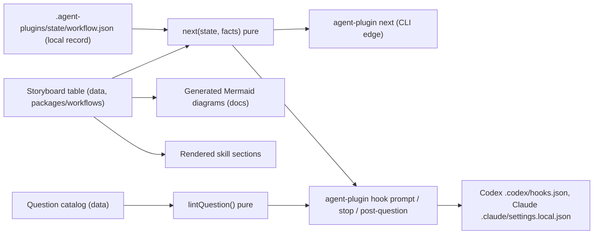

# Guided workflow and question quality: first implementation plan

Status: **draft r1 for the owner's review** (2026-11-21). Nothing here is decided until approved.
Source research: [monolithic-dev-harness-patterns.md](../monolithic-dev-harness-patterns.md), [host-interaction-tools.md](../host-interaction-tools.md).
Linear project: Unified Plugin Framework (P-AGE-6). No tickets are created until this plan is approved.

## Goal

Keep the agent oriented and moving inside a UPF workflow, and make every question it asks the user easy to answer. That means:

1. The agent always knows **where it is** in a workflow and **which directions are open**, without re-reading skills.
2. A turn never ends mid-workflow with nothing for the user to answer. The agent is told the **next action**.
3. Questions go through the **host's native question tool** where one exists, and they are **plain**.
4. The user can always **switch the guidance off**.
5. Test projects are never overwritten.

## Principles (borrowed lessons)

From the harness's assurance ADR and lockup plans, applied to UPF from day one:

- **Hooks are local and bounded.** No network, no tracker and no git inside a hook. Only small local records are read. Each hook has a time budget below the host limit.
- **Guidance, not gates, by default.** Every new hook *adds context* or *nudges once*. None of them denies a tool in this plan. Denial rows are added only when a trial shows text was not enough.
- **Every nudge has a way out, and never repeats.** `Stop` respects `stop_hook_active`. A nudge that was ignored once is not repeated in the same turn.
- **The state table is the single source.** Skills, hook text, `next` and the diagrams are all derived from it.
- **Pure core, thin edges.** Evaluation lives in pure TypeScript in `packages/workflows`. Files and stdin/stdout live in one CLI edge (`agent-plugin hook <event>`), interpreted once.

## Architecture



### Data shapes (sketch)

```typescript
// packages/workflows/src/storyboard.ts
type StateId = string & { readonly __brand: "StateId" };

interface Direction {
  readonly id: string;              // "deepen", "pressure-test", "write-design"
  readonly label: string;           // plain words shown to the user
  readonly to: StateId;
  readonly skill?: string;          // skill to run for this direction
}

interface StoryboardState {
  readonly id: StateId;
  readonly workflow: "discovery" | "implementation" | "code-review" | "project-tracking";
  readonly purpose: string;         // one line: what this state is for
  readonly rules: ReadonlyArray<string>; // short imperatives
  readonly ask?: QuestionId;        // catalog question that ends this state, if any
  readonly directions: ReadonlyArray<Direction>;
  readonly terminal: boolean;
}

type Next =
  | { readonly tag: "idle" }                                   // no active workflow
  | { readonly tag: "waiting"; readonly question: QuestionId } // user owes an answer
  | { readonly tag: "step"; readonly state: StoryboardState }
  | { readonly tag: "complete"; readonly workflow: string };
```

The local record (`.agent-plugins/state/workflow.json`) holds only `{ workflow, state, operation, enteredAt, pendingQuestion? }`. It is written by `agent-plugin workflow enter|move|leave|ask` and read by hooks. A missing or broken record means **idle**: it is moved aside, never fatal (harness lesson: never deny over your own broken state).

## Slices

Each slice is one Linear ticket, delivered on its own branch and PR in this order (one ticket at a time, per `AGENTS.md`). Each slice ships alone and is useful alone.

### Slice 0: Fresh test copies (small, do first)

**Why:** structurally prevents overwriting a live test project.

- `scripts/test-project.mjs` (`pnpm test-project [--version vX.Y.Z] [--from <template>]`): copies the template to the **next unused** sibling `…/test-project-template_<version>-NNN/`, installs the release there, and prints the path. It **never deletes or overwrites**. If a target exists, it takes the next number.
- Document it in `docs/test-matrix.md`.
- **Tests:** a pure `nextFreeName(existing, base)` with unit tests. An integration test in a `/tmp` scratch dir confirms an existing folder is left byte-identical.

### Slice 1: Plain-question linter + question catalog (AGE-113 follow-up)

**Why:** measurable question quality on every host, with no workflow state needed.

- `packages/workflows/src/question-lint.ts`: a pure `lintQuestion(input) -> ReadonlyArray<Problem>`. It normalizes Claude `AskUserQuestion` and Codex `request_user_input` inputs (Codex options may be bare strings) and checks for:
  - more than one question per call (configurable: Codex allows up to 3, so per-host limit);
  - a question over 50 words, or an option description over 25 words;
  - more than one `?` in a question;
  - more than 3 options, or a self-added `Other` (native controls add their own);
  - jargon: file paths, backticked code, skill or tool names, UPF internal ids;
  - pre-filled answers.
- `packages/workflows/src/question-catalog.ts`: standard questions as data (`id`, `question`, ≤ 3 options with `label`/`detail`, `recommended`, slots). Start with `en` and leave a `pt-br` field optional. Seed it with the discovery mode choice, discovery directions and the installer host choice.
- Hook edge: `agent-plugin hook pre-question` on `PreToolUse` with matchers `AskUserQuestion` (Claude) and `^(functions\.)?request_user_input$` (Codex). On problems it emits **context only** ("rewrite: …"). It is not a deny in this slice. Promote it to deny after a trial.
- Register the hook in `host-specs.ts` / `host-table.ts` next to the MAKS hooks, merged non-destructively (same pattern as `mergeMaksHooks`), and update `pnpm specs:verify`.
- **Tests:** a lint table test (good and bad examples per rule, both host shapes) and a hook I/O test with stdin JSON in and stdout JSON out.

### Slice 2: Storyboard table + pure `next` + generated diagrams

**Why:** the single source of truth for orientation. Nothing is enforced yet.

- `packages/workflows/src/storyboard.ts`: the types above and the **discovery** table first. It derives from `docs/workflows/discovery.md`: frame → ground → interview loop → elicitation (thorough/comprehensive) → directions after elicitation → pressure-test → write design → review → approved.
- Build-time validation (`validateStoryboard`): unique ids, every `to` exists, every `ask` exists in the catalog, every `skill` is in the adapter's mapped skills, every non-terminal state has ≥ 1 direction, and every state is reachable from the entry state.
- `next(table, record, facts) -> Next` as a pure function with exhaustive `switch` on the record.
- `scripts/storyboard-diagram.mjs --write|--check`: generates Mermaid into `docs/workflows/discovery.md` between markers. `--check` is added to CI next to `specs:verify`.
- CLI edge: `agent-plugin next [--project]` prints the `Next` result as JSON and plain text. `agent-plugin workflow enter|move|leave` writes the record.
- Elicitation as a pure reducer (`reduceElicitation(state, event) -> Either<Failure, State>`, phases `choose → apply → directions`). This is the moment you described: after methods run, the state's `directions` are the list the agent offers.
- **Tests:** table validation (one broken fixture per rule), `next` across every state, reducer transitions including invalid ones, and the diagram check.

### Slice 3: Orientation injection

**Why:** the agent sees its position and options at the moments that matter.

- `agent-plugin hook prompt` (`UserPromptSubmit`) and `agent-plugin hook session-start` (`SessionStart`): when a workflow is active, add ≤ 15 lines of context: workflow, state purpose, rules, open directions as a numbered list, and the catalog question id to ask.
- `agent-plugin hook post-question` (`PostToolUse` on the question tool): after the user answers, inject the directions of the **new** state. This covers "after the elicitation options ran, show the directions".
- Skills: discovery skills gain one line: "Run `agent-plugin workflow move <direction>` when a direction is chosen." The renderer derives this from the table (no hand-written state names in skills).
- Budget: each hook finishes within 5 s or emits nothing plus a one-line notice. A timing line is written to `.agent-plugins/state/hook-timing.log`.
- **Tests:** hook I/O per host shape, the idle → silent case, and a broken-record → idle case with the record moved aside.

### Slice 4: Turn-end `next` nudge

**Why:** no mid-workflow turn ends without a question or a next step.

- `agent-plugin hook stop` (`Stop`) passes the turn when any of these holds:
  - no workflow is active;
  - the state is terminal;
  - `stop_hook_active` is true;
  - a question is pending;
  - the final message ends with a question;
  - the turn used the native question tool;
  - guidance is suspended.

  Otherwise it returns `{"decision":"block","reason": <next() rendered inline>}` **once**. The agent does not need to call anything to learn the next step.
- Codex and Claude share the same output shape. Cursor and Antigravity are documented as "orientation only" until their stop events are verified.
- **Tests:** a decision table test over the pass conditions (switch on a tuple, per the FP rules) and a loop-guard test.

### Slice 5: Suspend / resume / free mode

**Why:** the user's way out, required before any hook could ever deny. It ships with or right after Slice 4.

- The prompt hook matches `suspend guidance`, `resume guidance` and `free mode` **first**, before anything else. It writes `.agent-plugins/state/guidance.json`. Every UPF hook reads it and goes silent while suspended. Free mode keeps question linting but drops workflow nudges.
- A small `guidance-controls` skill offers the same three choices through the native question tool.
- **Tests:** precedence (the control phrase beats everything) and each hook silent while suspended.

### Later (not in this plan)

- Promote the question linter or nudges to **deny** where trials show need, each with a written "way out" and a test proving it is allowed.
- Show-before-approve (digest-bound document approvals) for discovery documents.
- Knowledge-first reminder (one non-blocking nudge per prompt) using `Project_Knowledge`.
- Storyboards for implementation, code-review and project-tracking.
- A broken-link and skill-name/folder check in a `repo:check` script.

## Order and size

| Slice | Size | Depends on |
|---|---|---|
| 0 Fresh test copies | S | — |
| 1 Question linter + catalog | M | AGE-113 branch merged |
| 2 Storyboard + `next` + diagrams | M–L | 1 (catalog ids) |
| 3 Orientation injection | M | 2 |
| 4 Stop nudge | S | 2, 3 |
| 5 Guidance controls | S | 3 (ships with 4) |

Before Slice 1: commit and merge the open AGE-113 work (host question tool docs, `default_mode_request_user_input`, numbered-fallback rule) on `feature/AGE-113-host-interaction-controls`.

## Verification

- Per slice: narrow package build and tests while working. The full suite (`pnpm install --frozen-lockfile`, `build`, `typecheck`, `test`, `payloads:verify`, `specs:verify`, hook tests) runs once before push.
- Live trial after Slices 3 and 4. Use a fresh copy made by Slice 0, run a `discover-thorough` session on Codex and on Claude Code, and record the following:
  - Does the agent state its position and offer the table's directions after elicitation?
  - Are questions native and plain?
  - Does any turn end mid-workflow without a question or a next step?
  - Did any hook run long, loop or need suspension?

## Open questions for the owner

1. **Record location.** Is `.agent-plugins/state/` right, next to `host-specs.json`, and should it be git-ignored?
2. **Linter strictness.** Context-only nudges first (proposed), or deny from the start on Claude?
3. **First storyboard.** Is discovery first right, or would you rather start with implementation?
4. **Languages.** Is `en` only for the catalog now, or `en` + `pt-br` from the start like the harness?
5. **Codex question limit.** Codex `request_user_input` accepts up to 3 questions per call. Allow that, or keep the harness's one-at-a-time rule everywhere?
6. **Hook entry.** Extend `agent-plugin` with `hook <event>` (proposed), or add a separate `.upf-tools/bin/upf-guide` launcher?
