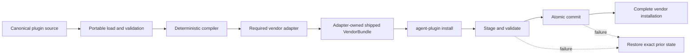

# Design Doc: Vendor Payload Compiler and Transactional Installer

## Context

`agent-plugins-toolkit` v0.1.0 validates and inspects a portable plugin root containing `plugin.json`, immediate-child Skills, and optional MCP configuration. `@agent-plugins/core` is deliberately vendor-neutral and inspection-only; `@agent-plugins/cli` exposes `validate` and `inspect`. The repository does not yet produce the different filesystem layouts, schemas, manifests, hook shapes, rule frontmatter, or installation targets required by Claude, Cursor, and Codex.

Maintaining those outputs as independent authored trees would make one plugin version have multiple sources of truth. Building at installation time would instead make installation dependent on toolchains, introduce non-determinism, and create more than one delivery path. The selected architecture keeps one canonical authored source, compiles complete vendor payloads before release, ships each payload with the adapter that owns it, and installs the chosen payload through one shared transaction engine.

Compilation and installation are intentionally distinct lifecycle responsibilities, but only installation is a user delivery workflow:

- **Release responsibility:** deterministic compiler plus one required adapter produces, validates, and packages the vendor payload.
- **User operation:** `agent-plugin install` verifies and transactionally installs the already-built payload.

There is no installation-time build, separate wiring, activation phase, post-install generator, dynamic artifact service, or vendor-specific installation command.

## Goals

1. Compile identical canonical input with the same adapter and toolchain into byte-identical vendor bundles for Claude, Cursor, and Codex.
2. Isolate every vendor-specific field, path, schema, transformation, validator, and installation-plan rule inside exactly one vendor adapter.
3. Ship one complete, verified vendor payload with each adapter and detect any source-to-payload drift before release.
4. Install any supported vendor bundle through one common transaction that is contained, idempotent, atomic where supported, and exactly reversible on failure.

## Non-Goals

- Executing the compiler during installation.
- Downloading, resolving, or choosing among alternative payload sources during installation.
- Supporting a wire, activate, repair, bootstrap, post-install, or second-stage command.
- Supporting vendors other than Claude, Cursor, and Codex in M4.
- Providing a fallback, generic, partially implemented, or dynamically discovered adapter.
- Letting adapters mutate installation targets directly.
- Moving vendor-specific types or dependencies into `@agent-plugins/core`.
- Executing Skill bodies, hooks, MCP servers, or other plugin-controlled programs while compiling, validating, or installing.
- Proving that plugin behavior is trustworthy; the system proves payload integrity and schema conformance.
- Implementing marketplace publishing APIs or multiple distribution mechanisms.
- Editing generated payloads as a development workflow.

## Proposed Design

### Single path



The arrows define one mandatory sequence. Vendor selection chooses one adapter from the closed registry; it does not select another workflow.

### Package boundaries

The implementation adds layers outside the existing portable core:

```text
@agent-plugins/core
  Portable types, loading, inspection, and diagnostics
            ↓
@agent-plugins/compiler
  VendorAdapter contract, VendorBundle model, deterministic compiler
      ↓              ↓                 ↓
adapter-claude  adapter-cursor  adapter-codex
  Vendor schemas, rendering, validation, install-plan logic, shipped payload
      └──────────────┬─────────────────┘
                     ↓
@agent-plugins/installer
  Preflight, locking, staging, journal, commit, rollback
                     ↓
@agent-plugins/cli
  validate, inspect, and the single install command
```

`core` MUST NOT import compiler, adapters, installer, or CLI. Adapters depend on the portable model and compiler contract. Installer consumes a verified bundle and installation plan but contains no vendor schema. CLI is the composition root and registers the three adapters explicitly.

### Canonical source

The compiler consumes a normalized portable inspection rather than reparsing vendor-specific files. Canonical authored inputs remain under the plugin root. M4 extends the canonical schema with required neutral rule, hook-intent, and distribution declarations that contain no vendor field names or paths.

Canonical content is authored exactly once. A semantic value that differs by vendor is either:

1. an adapter rule derived from portable input; or
2. a rejected unsupported construct with a diagnostic.

It MUST NOT be expressed as a second authored vendor copy.

### Adapter contract

Each required adapter is statically registered and implements the complete contract:

```ts
interface VendorAdapter {
  readonly vendor: VendorId;
  readonly adapterVersion: string;
  readonly vendorSchemaVersion: string;

  readonly compile: (
    plugin: CanonicalPlugin,
  ) => InspectionResult<VendorBundle>;

  readonly validate: (
    bundle: VendorBundle,
  ) => readonly Diagnostic[];

  readonly planInstallation: (
    bundle: VendorBundle,
    target: InstallTarget,
  ) => InspectionResult<InstallPlan>;
}
```

The contract is all-or-nothing. Registration fails when any operation, schema identity, or shipped payload is absent. Adapters return immutable values and diagnostics; they do not write the build directory or installation target.

All vendor knowledge resides below the adapter boundary, including manifest shapes, filenames, directory layout, hook event names, matchers, frontmatter, component mappings, install-relative paths, and vendor schema validation.

### Vendor bundle

A `VendorBundle` contains:

- bundle schema version;
- canonical plugin name and version;
- closed vendor identifier;
- adapter and vendor schema versions;
- canonical source digest;
- payload digest;
- lexically ordered payload file descriptors containing relative path, SHA-256, byte length, and portable mode;
- immutable file content supplied separately from the manifest;
- one relative installation plan or the inputs required to produce it deterministically.

Paths MUST be normalized relative paths. Absolute paths, empty segments, `.`/`..` traversal, NUL bytes, backslash ambiguity, duplicate normalized paths, and symlink payload entries are rejected. Generated provenance lives in the bundle manifest or a sidecar controlled by the toolkit; adapters MUST NOT inject provenance fields into closed vendor schemas.

### Release-time compilation

`compilePlugin` performs the same sequence for all vendors:

1. Load and validate canonical input through core.
2. Resolve one explicit vendor from the closed registry.
3. Invoke that adapter's pure compiler.
4. Validate the in-memory bundle with the adapter and common bundle validator.
5. Materialize it into a staging directory with stable formatting, line endings, ordering, timestamps, and file modes.
6. Re-read and digest staged bytes.
7. Atomically replace the adapter-owned shipped payload directory.

The release check regenerates into an isolated directory and compares bytes. Any difference fails CI. Shipped payloads are generated artifacts, not sources; a do-not-edit notice or sidecar marks this without violating vendor schemas.

### One transactional installation

The only operation is:

```sh
agent-plugin install <plugin> --vendor <claude|cursor|codex> --target <directory>
```

`<plugin>` identifies a canonical plugin distribution containing the shipped adapter payloads. The command selects the requested bundle, verifies its manifest and digests, asks the registered adapter for the relative installation plan, and sends that plan to the common installer.

The installer executes one algorithm:

1. Resolve and validate the explicit target.
2. Acquire an exclusive per-target lock.
3. Verify bundle identity, provenance, file digests, path containment, target permissions, and collisions without mutation.
4. Create staging and rollback-journal directories on the target filesystem.
5. Materialize the complete planned target in staging.
6. Validate the staged installation through the adapter validator.
7. Back up every path that will be replaced.
8. Commit atomically where supported, or perform journaled replacements in deterministic path order.
9. Verify installed bytes and write the installed-bundle record.
10. Remove the journal and release the lock.

Any failure after mutation begins triggers rollback from the journal. Rollback verifies restored managed state before reporting completion. For this contract, managed state means the presence or absence, bytes, and portable modes of every path owned or mutated by the transaction, plus preservation of every unrelated path. Ownership, access-control lists, extended attributes, and timestamps are never mutated and are outside the portable equality assertion. A rollback failure is reported separately and preserves the journal for manual recovery.

### Idempotency and upgrades

An existing installed-bundle record with the same plugin, vendor, adapter version, and payload digest makes installation a successful no-op after verification. A different digest is an upgrade through the same transaction. Files previously owned by the installed bundle but absent from the new plan are removed transactionally; unrelated target files are preserved unless they collide with a planned path, in which case preflight fails.

No downgrade-specific workflow exists. Installing an older valid bundle is the same transaction and MUST be permitted only when its compatibility policy accepts the currently installed version.

### Diagnostics and observability

Expected failures are values with stable categories:

- canonical input;
- adapter selection or conformance;
- bundle integrity;
- install preflight;
- lock;
- staging;
- commit;
- rollback;
- installed verification.

The CLI emits a machine-readable result containing plugin, version, vendor, adapter version, bundle digest, target, outcome, changed path count, and rollback outcome. Sensitive file content and environment values are never logged.

## Alternatives Considered

| Alternative | Benefit | Reason rejected |
| --- | --- | --- |
| Author a separate plugin tree per vendor | Directly visible vendor files | Creates multiple sources of truth and inevitable drift. |
| Compile during installation | No shipped generated payload | Introduces toolchain dependency, non-determinism, latency, and a second responsibility in the install path. |
| Dynamic artifact service | Avoids storing release artifacts | Adds network availability, caching, integrity, and multiple-delivery complexity. |
| Native marketplace-specific installers | Fits each marketplace | Produces different user workflows and prevents a common transaction/rollback contract. |
| Adapter writes targets directly | Less shared installer code | Duplicates mutation logic, weakens rollback, and allows vendor logic to bypass containment controls. |
| One superset payload for every vendor | One output tree | Vendors have incompatible closed schemas and discovery paths; a superset can be invalid. |
| Post-install generation or wiring | Defers project-specific materialization | Violates the single-operation requirement and can leave a partially active installation. |
| Optional adapter discovery | Third-party extensibility | Adds fallback and compatibility branches before the three required adapters establish a stable contract. |

## Rollout & Observability

M4 is delivered through AGE-14–AGE-23 and targets 2026-09-25. The compiler and adapters land before the installer is exposed. The existing `validate` and `inspect` commands remain backward compatible throughout development. `install` is not released until all three adapter payloads, transaction rollback, drift checks, and end-to-end tests pass.

Release gates are:

- workspace build and typecheck;
- shared adapter conformance for all three vendors;
- byte-identical regeneration;
- vendor payload validation;
- containment and symlink tests;
- fault-injected rollback at every mutation point;
- install, reinstall, upgrade, downgrade-policy, and failed-upgrade cases;
- documentation command verification.

Observability is local and deterministic: JSON diagnostics, compiler provenance, bundle manifests, install result, and rollback journal. There is no telemetry service. CI failure is the release alert.

Rollback before release is removal of the unreleased packages and CLI command while preserving core. After release, consumers may pin the prior package version. A failed local installation rolls back within the same command. Generated payloads can be restored by rebuilding from the tagged canonical source and adapter version; they are never repaired manually.

## Security

The compiler and installer operate on untrusted plugin content but trusted toolkit adapters. They MUST NOT execute Skills, hooks, MCP commands, generated scripts, or plugin-provided adapter code. Vendor adapters are versioned source modules shipped by this toolkit and reviewed as executable code.

Security controls include:

- canonical validation before adapter invocation;
- no dynamic adapter loading;
- path normalization and containment before writes;
- rejection of symlink payload entries and symlink escape in target ancestors;
- digest verification before staging and after commit;
- staging on the destination filesystem;
- exclusive installation lock;
- least-permission preflight;
- backup journal with restricted permissions;
- preservation of unrelated target content;
- no secrets or file contents in diagnostics;
- no network access during compilation or installation;
- rollback verification after any partial mutation.

There is no authentication layer because the toolkit is a local CLI. Authorization is the invoking operating-system user's filesystem permission. The installer MUST NOT elevate privileges or silently widen permissions.
