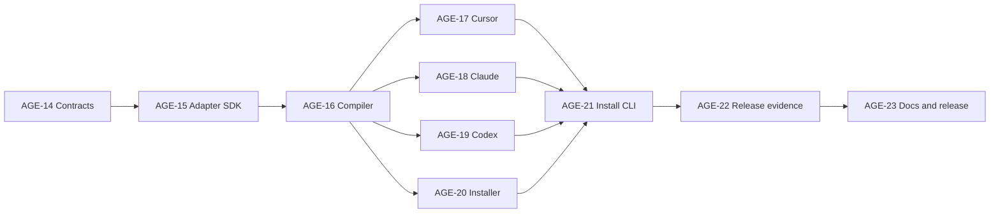

# Implementation Plan: AGE-13 Vendor Payload Compiler and Installer

## Scope

### In scope

- Canonical, vendor-neutral declarations required to compile complete Claude, Cursor, and Codex plugin payloads.
- Common immutable bundle and installation-plan contracts.
- One complete adapter SDK and one conformance harness.
- Exactly three required adapters: Claude, Cursor, and Codex.
- Deterministic release-time compilation and adapter-owned shipped payloads.
- Regenerate-and-diff drift enforcement.
- One shared transactional installer with preflight, target lock, staging, journal, commit, verification, idempotency, upgrade, and rollback.
- One command: `agent-plugin install <plugin> --vendor <claude|cursor|codex> --target <directory>`.
- Cross-platform, security, conformance, lifecycle, documentation, and release evidence.

### Out of scope

- Install-time compilation or toolchain provisioning.
- A wire, activate, repair, bootstrap, post-install, or second-stage command.
- Dynamic artifact services, payload downloads, network fallback, or multiple delivery strategies.
- Native marketplace publishing APIs.
- Optional or third-party adapters, adapter discovery, fallback adapters, or vendors beyond Claude, Cursor, and Codex.
- Plugin-controlled adapter code.
- Moving vendor-specific behavior into `@agent-plugins/core`.
- Executing plugin Skills, hooks, scripts, or MCP servers.

## Milestones

The Linear milestone is [M4 — Vendor Payload Compiler & Transactional Installer](https://linear.app/agentical-monolithics/project/agent-plugins-toolkit-491f93eacad2), targeted for 2026-09-25. Implementation is organized as seven calendar checkpoints; the installation architecture remains one path regardless of implementation sequencing.

| Checkpoint | Dates | Exit condition | Linear tickets |
| --- | --- | --- | --- |
| Contract lock | Aug 10–14 | Canonical, bundle, plan, record, compatibility, and containment contracts accepted and tested | AGE-14 |
| Adapter foundation | Aug 17–21 | Complete adapter interface, frozen registry, deterministic formatting, and shared harness green | AGE-15 |
| Compiler pipeline | Aug 24–28 | Compiler produces atomic, reproducible, drift-checked shipped bundles | AGE-16 |
| First vendor payloads | Aug 31–Sep 4 | Claude and Cursor payloads pass pinned schemas and shared conformance | AGE-17, AGE-18 |
| Complete payload and transaction engine | Sep 7–11 | Codex payload passes; common installer proves idempotency and injected-failure rollback | AGE-19, AGE-20 |
| Single command | Sep 14–18 | Strict `agent-plugin install` works end to end for all three shipped payloads | AGE-21 |
| Release evidence | Sep 21–25 | Security, drift, rollback, cross-platform, docs, and release gates green | AGE-22, AGE-23 |

The estimates total 49 points across ten child tickets. The timeline assumes one primary implementation stream with Claude and Cursor adapter work allowed to proceed concurrently after AGE-16. If only one engineer is available, AGE-17 then AGE-18 execute sequentially within the same checkpoint and scope must not be reduced to meet the date.

## Tasks

### AGE-14 — Define canonical source, vendor bundle, and installation contracts — 3 points — due Aug 14

- [ ] Add branded vendor, digest, and normalized relative-path constructors.
- [ ] Define `CanonicalPlugin`, neutral rule and hook-intent declarations, and source digest rules.
- [ ] Define `VendorBundle`, payload file, installed record, journal entry, and install-plan unions.
- [ ] Specify stable canonical JSON/text encodings and payload digest vectors.
- [ ] Add path-containment, duplicate-path, closed-schema, and package-boundary tests.
- [ ] Confirm `@agent-plugins/core` imports no compiler, adapter, installer, or CLI code.

### AGE-15 — Implement adapter SDK and conformance harness — 5 points — due Aug 21

- [ ] Create the complete immutable `VendorAdapter` contract.
- [ ] Create a frozen registry requiring Claude, Cursor, and Codex with no default.
- [ ] Add common bundle and install-plan validators.
- [ ] Add stable JSON, Markdown, line-ending, mode, and path formatting helpers.
- [ ] Add golden-payload and regenerate-twice conformance helpers.
- [ ] Prove adapter compile, validate, and plan operations perform no filesystem writes.

### AGE-16 — Implement deterministic compiler and shipped-payload pipeline — 5 points — due Aug 28

- [ ] Normalize valid filesystem inspection into `CanonicalPlugin`.
- [ ] Implement `compilePlugin` with explicit vendor selection and no fallback.
- [ ] Materialize into same-filesystem staging and atomically replace output.
- [ ] Re-read staged bytes and produce the canonical bundle and payload digests.
- [ ] Store generated provenance outside closed vendor documents.
- [ ] Implement `verifyShippedPayload` and release drift scripts.
- [ ] Generate and package reference payloads from `plugins/hello-world`.

### AGE-17 — Implement Cursor adapter and payload — 5 points — due Sep 4

- [ ] Pin authoritative Cursor schema fixtures and version metadata.
- [ ] Map every supported canonical component to Cursor paths and shapes.
- [ ] Implement Cursor-specific frontmatter, hook, manifest, and payload validation.
- [ ] Return the complete Cursor installation plan.
- [ ] Generate, package, and drift-protect the Cursor hello-world payload.
- [ ] Pass the shared adapter conformance suite.

### AGE-18 — Implement Claude adapter and payload — 5 points — due Sep 4

- [ ] Pin authoritative Claude schema fixtures and version metadata.
- [ ] Map every supported canonical component to Claude paths and shapes.
- [ ] Implement Claude-specific manifest, hook, and payload validation.
- [ ] Return the complete Claude installation plan.
- [ ] Generate, package, and drift-protect the Claude hello-world payload.
- [ ] Pass the shared adapter conformance suite.

### AGE-19 — Implement Codex adapter and payload — 5 points — due Sep 11

- [ ] Pin authoritative Codex schema fixtures and version metadata.
- [ ] Map every supported canonical component to Codex paths and shapes.
- [ ] Implement Codex-specific matcher, manifest, hook, and payload validation.
- [ ] Return the complete Codex installation plan.
- [ ] Generate, package, and drift-protect the Codex hello-world payload.
- [ ] Pass the shared adapter conformance suite.

### AGE-20 — Implement transactional installer — 8 points — due Sep 11

- [ ] Validate bundle schema, provenance, digests, plan completeness, target, permissions, containment, symlinks, and collisions before mutation.
- [ ] Implement exclusive per-target installation lock and stale-lock diagnostics.
- [ ] Build complete target state under same-filesystem staging.
- [ ] Validate the staged vendor payload before commit.
- [ ] Write and durably flush backup journal entries before mutations.
- [ ] Commit atomically where supported and deterministically journal replacements otherwise.
- [ ] Write and verify the installed-bundle record.
- [ ] Implement identical reinstall no-op and transaction-based upgrade behavior.
- [ ] Inject failure at every mutation point and verify managed paths are restored byte-for-byte and mode-for-mode while unrelated paths remain unchanged.
- [ ] Preserve a recovery journal and return `rollback-failed` when restoration cannot complete.

### AGE-21 — Expose the single install command — 5 points — due Sep 18

- [ ] Add strict parsing for the required plugin, vendor, and target inputs.
- [ ] Reject missing, duplicate, unknown, and extra inputs before mutation.
- [ ] Resolve only the shipped bundle owned by the selected registered adapter.
- [ ] Invoke the common installer without importing or invoking compiler entrypoints.
- [ ] Emit stable JSON result envelopes and documented exit codes.
- [ ] Add end-to-end CLI coverage for all three vendors and all result variants.
- [ ] Confirm no other installation or activation command is exposed.

### AGE-22 — Verify conformance, drift, security, and rollback — 5 points — due Sep 23

- [ ] Execute common adapter contract tests for all three required adapters.
- [ ] Add regeneration drift gates for missing, extra, changed, and mode-changed files.
- [ ] Test path traversal, absolute paths, NUL, Unicode normalization, backslashes, duplicate normalized paths, and symlink escape.
- [ ] Test poisoned bundle, stale digest, permission, collision, and lock contention failures.
- [ ] Test install, reinstall, upgrade, accepted older bundle, rejected incompatible downgrade, and failed upgrade for all vendors.
- [ ] Add Windows, macOS, and Linux CI coverage where runners are available to the project.
- [ ] Assert installation performs no compilation, plugin execution, privilege elevation, or network access.

### AGE-23 — Document and release — 3 points — due Sep 25

- [ ] Replace the obsolete two-stage adapter proposal with the accepted one-path architecture.
- [ ] Add README diagrams for source, compiler, adapter-owned payload, and transaction.
- [ ] Document canonical authoring, generated-file policy, adapter responsibilities, and conformance.
- [ ] Document exactly one installation command for the three vendors.
- [ ] Publish rollback/recovery and compatibility guidance.
- [ ] Exercise every documented command during release verification.
- [ ] Update changelog and release notes with milestone, specs, tickets, adapter versions, and payload digests.

## Dependencies

### Ticket graph



- AGE-14 blocks AGE-15.
- AGE-15 blocks AGE-16.
- AGE-16 blocks all three adapter implementations and the transaction engine.
- AGE-17, AGE-18, AGE-19, and AGE-20 jointly block AGE-21.
- AGE-21 blocks AGE-22; AGE-22 blocks AGE-23.

M2 and M3 remain separate project milestones and are not implicit blockers. Any prerequisite they own that is required by M4 MUST be represented explicitly in AGE-14, AGE-15, or AGE-22 rather than creating a hidden cross-milestone dependency.

External dependencies are limited to Node.js `>=22`, pnpm `10.x`, TypeScript, the local filesystem, and version-pinned vendor schema fixtures. Runtime compilation, network services, marketplace APIs, and vendor CLIs are not installer dependencies.

## Validation

### Per-ticket gate

Every ticket MUST:

1. build and type-check its affected packages;
2. pass new unit and contract tests;
3. preserve all existing `validate` and `inspect` behavior;
4. contain no manually edited generated payload;
5. update the relevant accepted spec when an observable contract changes.

### Milestone acceptance

Run:

```sh
pnpm build
pnpm typecheck
pnpm test
pnpm payloads:verify
```

Then install the shipped hello-world payload for each required vendor into an isolated temporary target and verify:

- the resulting tree matches the adapter golden tree;
- the installed record matches the bundle manifest;
- reinstall is unchanged;
- upgrade removes only previously owned stale files;
- unrelated files remain untouched;
- an injected commit failure restores every managed path byte-for-byte and mode-for-mode and leaves unrelated paths unchanged;
- install source contains no compiler or network call path;
- all documented commands and JSON examples match real output.

Release sign-off requires the AGE-22 evidence report, completed AGE-14–AGE-23 tickets, accepted local specs, green cross-platform CI, and zero regenerate-and-diff changes.

## Rollback

Implementation merges are package-isolated so compiler, adapters, installer, and CLI composition can be reverted without altering portable core data. Before the first release, disabling the unreleased `install` export and removing the new packages returns the repository to v0.1.0 behavior.

Generated payload rollback is regeneration from the selected prior source tag and adapter version. Manual payload changes are forbidden.

Installer failure rollback is mandatory and synchronous within the one command. The reverse journal restores modes and bytes, removes created paths, verifies prior digests, and releases the lock only after verification. If rollback verification fails, the installer preserves backups and journal, returns exit `5`, and prints the recovery-journal path. It MUST NOT retry through another installation path or claim success.
