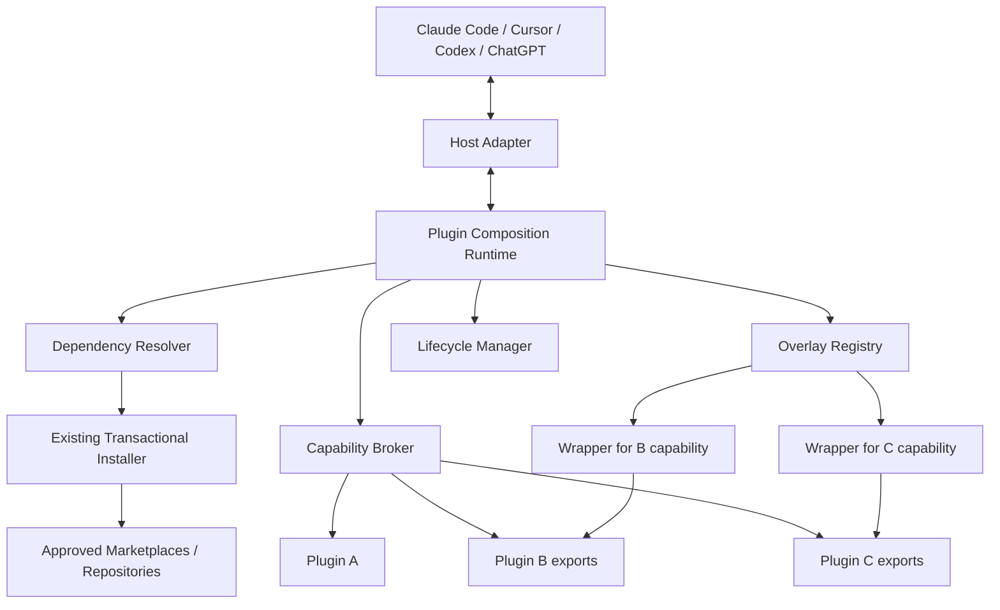

# Unified Plugin Contract

**Status:** Research and architecture proposal, draft 0.1  
**Date:** 2026-11-14  
**Scope:** Dependency management, capability composition, non-invasive customization, and coordinated updates across agent hosts.  
**Change policy:** Research artifact only. No existing repositories or plugin installations have been modified.

## 1. Problem statement

Plugin A should be able to:

1. Declare Plugin B and Plugin C as dependencies.
2. Use exported resources and operations from both through stable contracts.
3. Request installation and updates of compatible dependency versions.
4. Customize accessible behavior through adapters and overlays without modifying either dependency's source or installed files.
5. Work on Claude Code, Cursor, and Codex / ChatGPT where the host's supported APIs and permissions allow it.

The goal is **one authoritative composition flow** with host-specific adaptation, not parallel implementations of the same business rule.

## 2. Verified findings

### 2.1 Existing project foundations

Inspected current `main` branch documentation for:

- [Agent Plugins Toolkit](https://github.com/Monolith-INC/agent-plugins-toolkit/blob/main/README.md) and its [architecture](https://github.com/Monolith-INC/agent-plugins-toolkit/blob/main/docs/architecture.md).
- [Toolkit installation design](https://github.com/Monolith-INC/agent-plugins-toolkit/blob/main/docs/vendor-payload-installation.md).
- [Monolithic Agent Guidelines](https://github.com/theocarranza/monolithic-agent-guidelines/blob/main/README.md).
- [Monolithic Development Harness](https://github.com/Monolith-INC/monolithic-dev-harness/blob/main/README.md).

The Toolkit already provides a portable manifest reader, component inspection, deterministic compiler, vendor adapters for Claude Code / Cursor / Codex, verified payloads, and a transactional installer with journaling and rollback. Its published `plugin.json` portable fields do **not** include a first-class dependency or capability contract. The `extensions` object is opaque to the existing portable core. The current installer handles one shipped payload per install operation; it is not a dependency graph resolver or remote artifact updater.

The Guidelines and Harness demonstrate useful separation of host adapters, runtime rules, retrieval, and lifecycle responsibilities; they are **not** currently being treated as plugin composition services.

### 2.2 Vendor-neutral standard

The [Agent Plugins 1.0.0 specification](https://agent-plugins.org/) standardizes plugin identity, skills and MCP servers. Its [normative JSON Schema](https://agent-plugins.org/schemas/1.0.0/plugin.schema.json) has no top-level `dependencies` or runtime `provides` / `requires` definitions. Unknown top-level fields are invalid under the schema's `additionalProperties: false`. Namespaced `extensions` objects are valid, but the standard defines no behavior for their contents.

**Consequence:** An experiment should use a properly namespaced `extensions` object or separate companion metadata, not add non-standard root fields. Only our compatible runtime would interpret it; other hosts could legally ignore it.

### 2.3 Current host support

| Host | Verified capability | Important limit |
| --- | --- | --- |
| Claude Code | Native plugin dependencies, versions/ranges, conflict combination, dependency installation/auto-update, cross-marketplace allowlist | Native dependency activation does not automatically create a typed capability binding or interception mechanism. See [dependency docs](https://code.claude.com/docs/en/plugins/dependencies). |
| Cursor | Loads Agent Plugins and native Cursor plugins with skills, MCP, hooks, other components | Its documented Agent Plugins implementation does not expand standard `${PLUGIN_ROOT}` / `${PLUGIN_DATA}` in `mcp.json`; use host adaptation. An equivalent dependency resolver was not established in the consulted [reference](https://prod.cursor.com/docs/reference/plugins). |
| Codex / ChatGPT | Portable Agent Plugins packaging, skills, MCP servers, optional hooks on supported local runtime surfaces, marketplaces | No equivalent native plugin dependency resolver was established in the consulted [packaging docs](https://developers.openai.com/plugins/build/plugins). Hook deployment and trust depend on surface. |

Claude Code supports dependency versions as semantic-version ranges and combines ranges from multiple consumers. Its cross-marketplace policy prevents silent unreviewed installs. Updating a marketplace / dependent plugin can update compatible dependencies. The exact semantics vary by source type; it is not a universal package manager.

OpenAI's [public plugin guidelines](https://developers.openai.com/plugins/plugin-guidelines) require independently usable public tools: tools must not instruct the model to invoke another plugin or connector. Therefore, a public Plugin A must not rely on a model-side chain of Plugin B's tool calls. If composition is needed, implement it inside an approved integration/server layer with separately authorized dependencies and expose a self-contained tool boundary.

## 3. Architectural principles

1. **One composition implementation.** Resolve dependencies, bind capabilities, apply overlays, and plan lifecycle actions through one logical runtime API.
2. **Delegate native machinery, not policy.** Use host capabilities when present, but reconcile the outcome with one contract and one desired dependency graph. Avoid two competing update managers.
3. **Immutable upstream artifacts.** Keep downloaded plugin versions, vendor-generated payloads, and installed originals unmodified. Store integration configuration and state separately.
4. **Explicit capability contracts.** Exported operations have stable identifiers, typed input/output schemas, capability versions, and declared effects/permissions.
5. **Least privilege.** Plugin A cannot silently gain B/C credentials, bypass user approvals, rewrite B/C files, or install across marketplaces without permission.
6. **Reproducible resolution.** Resolve versions once, record source identity and hashes in a lock, and verify before activation.
7. **Fail closed for mandatory dependencies.** Missing or incompatible required capabilities prevent dependent activation; optional dependencies may degrade gracefully.
8. **Host honesty.** A capability is portable only when the host supports the required invocation, lifecycle and permission surfaces. A manifest alone cannot create those surfaces.

## 4. Proposed component model



**Dependency Resolver:** Establishes a directed graph, detects cycles, resolves compatible package versions, validates provenance and host prerequisites, and produces a plan.

**Capability Broker:** Maps a requested contract and alias to a concrete provider and a permission-checked invocation route. It must distinguish *installed*, *enabled*, *exported*, *authorized*, and *operational*.

**Overlay Registry:** Applies ordered, composable configuration and wrappers to exported capability interfaces, not to arbitrary private implementation details.

**Lifecycle Manager:** Performs activate/deactivate/upgrade/rollback transactions, tracks dependents, manages explicit updates and optional policies, and coordinates native host refresh if supported.

**Existing Installer:** Reuses the Toolkit's verified bundle installation and rollback primitives. A graph-level coordinator can stage multiple artifact updates before committing a compatible set; the current installer does not already guarantee graph-level atomicity.

**Host Adapter:** Translates host-native manifests, permissions, startup, server access, hooks, and refresh commands into explicit adapter capabilities. Unsupported functionality is reported, never silently simulated.

## 5. Contract design

### 5.1 Package dependencies and capability requirements are different

- Package dependency: `plugin-a` requires `plugin-b` within a compatible package-version range.
- Capability requirement: `plugin-a` requires an exported `code.analysis` contract at version 1, optionally bound to `plugin-b`.
- A package being installed does not guarantee its capability is reachable, enabled, or authorized.
- A capability might eventually be supplied by a different plugin without changing Plugin A's processing flow.

### 5.2 Proposed manifest (illustrative, not an existing schema)

```json
{
  "$schema": "https://agent-plugins.org/schemas/1.0.0/plugin.schema.json",
  "name": "plugin-a",
  "version": "1.0.0",
  "description": "Compose analysis and testing workflows",
  "extensions": {
    "com.example.composition": {
      "contractVersion": "0.1.0",
      "dependencies": [
        {
          "name": "plugin-b",
          "version": "^2.0.0",
          "source": { "kind": "marketplace", "name": "approved-tools" },
          "optional": false
        },
        {
          "name": "plugin-c",
          "version": "~3.1.0",
          "source": { "kind": "marketplace", "name": "approved-tools" },
          "optional": false
        }
      ],
      "requires": [
        {
          "alias": "analyzer",
          "contract": "com.example.code-analysis",
          "version": "^1.0.0",
          "provider": "plugin-b"
        },
        {
          "alias": "tester",
          "contract": "com.example.automated-testing",
          "version": "^1.0.0",
          "provider": "plugin-c"
        }
      ],
      "overlays": [
        {
          "target": "analyzer",
          "kind": "wrapper",
          "entry": "./integration/validate-analysis"
        }
      ],
      "updatePolicy": "latest-compatible"
    }
  }
}
```

`com.example.composition` is a placeholder namespace. Use an owned reverse-domain namespace before standardizing. A host without a compatible composition runtime will ignore these semantics; plugin portability cannot be inferred from schema validity alone.

### 5.3 Provider contract (illustrative)

A provider would publish *exported* capabilities under the same namespace, for example:

```json
{
  "provides": [
    {
      "contract": "com.example.code-analysis",
      "version": "1.2.0",
      "transport": "managed-mcp",
      "server": "analysis-server",
      "operation": "analyze",
      "inputSchema": "./contracts/analyze-input.schema.json",
      "outputSchema": "./contracts/analyze-output.schema.json",
      "effects": ["read-project"]
    }
  ]
}
```

This describes a broker-managed transport and schemas, **not** a currently standardized host API. The broker must independently establish that `analysis-server` is reachable and that the consumer is permitted to invoke it. It must never assume MCP server registration in the host implies plugin-to-plugin invocation rights.

### 5.4 Bindings and invocation

Resolution produces explicit bindings such as:

```text
plugin-a requires "analyzer" -> plugin-b@2.4.1
  -> contract com.example.code-analysis@1.2.0
  -> permission-granted managed endpoint
  -> plugin-a validation wrapper
```

The Plugin A workflow receives an `analyzer` interface with one authoritative contract. It must not import private files from Plugin B or assume access to its secrets. An exported interface could be an MCP endpoint, an explicitly supported process API, or a host-approved reference. When invocation cannot be provided, dependency resolution reports `unsupported-host-capability` and does not pretend composition works.

## 6. Overlay model

Different mechanisms need different names:

| Technique | What it can do | Limitation |
| --- | --- | --- |
| Configuration overlay | Apply plugin-supported settings | Only supported keys and controls |
| Interface adapter | Convert one exported contract to another | Requires an accessible export |
| Wrapper/interceptor | Add validation, logging, output mapping, or policy checks around a call | Must control the invocation route; cannot intercept arbitrary host-native calls |
| Extension point | Register callbacks/providers intentionally exposed by Plugin B | Requires Plugin B to define an extension point |
| Host hook | Affect supported host lifecycle or tool events | Event coverage, trust, and host policy vary |

**Precedence proposal:** Administrator/host mandatory policy > user authorization > application composition policy > plugin-specific defaults. The overlay must not change a security decision from denied to allowed.

**Order proposal:** Explicit priority and deterministic sorting, with cycles/conflicts rejected. For a capability invocation: authorize → validate input → run pre-wrappers → invoke provider once → run post-wrappers → validate output → return. Failure handling must preserve the original error contract.

The dependency's installed source and generated vendor payload must remain untouched. An adapter cannot alter an unexported internal algorithm without the provider's participation or invasive interception.

## 7. Versioning and update semantics

Keep three version dimensions distinct:

1. **Package version:** Plugin B `2.4.1`.
2. **Capability contract version:** `com.example.code-analysis` `1.2.0`.
3. **Composition contract version:** The schema and runtime interpretation of `com.example.composition` `0.1.0`.

Suggested `latest-compatible` algorithm:

1. Read the desired graph and approved sources.
2. Resolve highest compatible versions against all dependent constraints, applicable platform requirements, and trust policy.
3. Fetch/check content digests and signatures where available; reject unapproved sources.
4. Build one **plan** before modifying anything; show permission changes and new capabilities.
5. Verify capability contracts and conformance tests against candidate providers and overlays.
6. Stage dependency changes and preserve a known-good graph/lock.
7. Activate as one coordinated update where supported; otherwise use explicit compensating rollback and report limitations.
8. Verify installation records, registrations, endpoint readiness, and bindings.
9. Commit lock data only after successful activation. On failure, restore the known-good graph and surface diagnostics.

The manager should never equate *newest published release* with *safe release*. Changing marketplace trust or granting new permissions needs a separate approval. Host-managed plugins and synchronized workspace plugins may be non-writable; an adapter must not bypass host controls.

The lock should record source marketplace/repository, resolved package version, source commit or artifact digest, adapter version, capability contract versions, bindings, and overlay version/digest. It must not include credentials.

## 8. Runtime states and failure behavior

Use explicit states: `declared`, `resolved`, `installed`, `enabled`, `bound`, `healthy`, `blocked`, `updating`, `rolled-back`.

Examples:

| Condition | Desired behavior |
| --- | --- |
| Mandatory dependency missing | Do not activate A; return missing dependency and candidate sources |
| Version constraints conflict | Reject the update before changing B/C |
| Provider installed but no matching capability export | Do not mark A ready |
| Plugin B cannot be called by runtime in this host | Report unsupported host invocation, do not substitute model-side chaining |
| Upstream update changes capability contract | Conformance failure; preserve previous compatible graph |
| Overlay cannot attach to target | Reject mandatory overlay or explicitly degrade optional overlay |
| Dependency source unknown or untrusted | Ask for review; do not auto-install |
| Plugin A uninstalled while B is shared | Retain B while another consumer or an explicit user installation needs it |

## 9. Security and policy requirements

- Treat plugins, repositories, and marketplaces as separate trust domains.
- Keep provenance and approval records for sources and cross-marketplace dependencies.
- Treat hooks, executable scripts, and MCP servers as executable capabilities requiring host-level authorization.
- Do not expose provider credentials to a consumer unless an explicitly scoped delegation mechanism exists.
- Restrict overlay access to declared exported contracts and explicit effects.
- Refuse overlays that would bypass mandatory checks or conceal dependency origin.
- Validate path containment, source hashes, component schemas, and invocation permissions.
- Separate *read-only inspection* from operations that install, enable, update, or execute plugins.

## 10. Proposed minimum viable scope

The first milestone should be **read-only planning and manifest validation**, not a live cross-host interceptor:

1. Define a namespaced composition extension schema and fixtures.
2. Inspect declared package dependencies, provided capabilities, requirements, and overlays.
3. Resolve dependency graphs against locally supplied metadata, with deterministic conflict and cycle diagnostics.
4. Validate capability contract compatibility and host support through adapter declarations.
5. Generate deterministic resolution plans and proposed locks without installation or execution.
6. Add conformance tests covering optional requirements, version conflicts, missing exports, and unsupported hosts.

Next milestone: use the Toolkit's installer to install a fixed, approved dependency set transactionally and record ownership/provenance.

Later milestone: add a broker for explicitly exported capabilities and non-invasive wrappers; only then add safe auto-update, conflict recovery, and higher-level composition workflows.

This ordering preserves the Toolkit's current boundaries and avoids pretending that host-specific runtime behavior is already portable.

## 11. Design decisions to review

| Decision | Recommendation | Status |
| --- | --- | --- |
| Where to put experimental metadata | Namespaced root `extensions`, not new top-level portable fields | Proposed |
| Who decides dependency policy | Shared composition runtime | Proposed |
| Who performs physical installation | Existing Toolkit installer or approved native host manager | Proposed |
| Can Plugin A directly modify B/C installation? | No | Proposed |
| Can Plugin A request updates? | Yes, via manager, policy, and authorization | Proposed |
| Can B/C be replaced by alternative providers? | Yes, if capability contract and permissions match | Proposed |
| Must all providers be callable by the broker? | Only for runtime composition; otherwise mark unsupported | Proposed |
| Are automatic updates enabled by default? | No; explicit opt-in and compatible-only | Proposed |
| Can multiple incompatible versions coexist? | Defer; first milestone resolves a single version per plugin identity per environment | Open |
| Is composition package-specific or a reusable library? | Shared Toolkit service/library, CLI entry points, host adapters | Proposed |
| Should this become part of the Agent Plugins standard? | Evaluate after implementation evidence and multi-host support | Open |

## 12. Verification criteria

- A manifests B and C while remaining valid under Agent Plugins 1.0.0 JSON Schema.
- Invalid dependency graph yields deterministic diagnostics with **no side effects**.
- Consumer binding succeeds only when package, capability, version, permissions, and invocation support all match.
- Two consumers with incompatible B constraints cannot silently replace one another's working dependency.
- Overlay wrapper changes accessible behavior without changing B's installed file hashes.
- Updating B while compatible preserves A's behavior and overlay binding; incompatible updates are rejected.
- Failure during graph-level activation leaves the prior graph functional or clearly reports unrecoverable limits.
- Native Claude Code resolver delegation preserves the logical dependency contract and does not bypass its marketplace allowlists.
- Cursor/Codex adapters report unsupported features honestly rather than mutating undocumented host files.
- Plugin A can be removed without removing shared dependencies owned by other plugins or users.

## 13. References

- Agent Plugins standard: https://agent-plugins.org/
- Agent Plugins schema: https://agent-plugins.org/schemas/1.0.0/plugin.schema.json
- Claude Code native dependencies: https://code.claude.com/docs/en/plugins/dependencies
- Claude Code manifest: https://code.claude.com/docs/en/plugins-reference
- Cursor plugins reference: https://prod.cursor.com/docs/reference/plugins
- OpenAI plugin packaging: https://developers.openai.com/plugins/build/plugins
- OpenAI plugin guidelines: https://developers.openai.com/plugins/plugin-guidelines
- Backstage extension-point design: https://backstage.io/docs/next/backend-system/architecture/extension-points/
- Toolkit architecture: https://github.com/Monolith-INC/agent-plugins-toolkit/blob/main/docs/architecture.md
- Toolkit installer: https://github.com/Monolith-INC/agent-plugins-toolkit/blob/main/docs/vendor-payload-installation.md
- Agent Guidelines: https://github.com/theocarranza/monolithic-agent-guidelines/blob/main/README.md
- Development Harness: https://github.com/Monolith-INC/monolithic-dev-harness/blob/main/README.md

---

**Research note:** This document distinguishes verified product/repository features from architectural proposals. No prototype, compatibility test, installation, or change to an existing project was performed.
