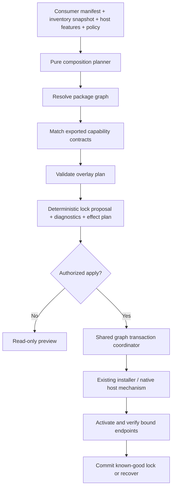

# Unified Plugin Contract — Implementation Plan

**Status:** Proposed; no implementation authorized or performed  
**Version:** 0.1  
**Date:** 2026-11-14  
**Target repository:** https://github.com/Monolith-INC/agent-plugins-toolkit  
**Architectural input:** `unified-plugin-contract-draft-v0.1.md` (research and design draft 0.1)  
**Scope:** Dependency declarations, deterministic resolution, capability contracts, non-invasive overlays, coordinated installation, and safe dependency updates.

## 1. Intended outcome

A consumer plugin A declares dependencies B and C and the capabilities it needs. The shared composition system can plan and, after separate authorization, install compatible dependencies, bind exported operations, apply managed wrappers without editing B/C, and update the dependency set while preserving the last known-good configuration.

**Operating rule:** One behavior, one authoritative implementation. All hosts use a common composition model and resolution policy. Host adapters translate mechanisms, not business rules.

**Permission boundaries:** This is a plan only. Repository edits require explicit `IMPLEMENTATION APPROVED`. No deletion is included or implied; deletion requires separate `CODEX DELETION AUTHORIZED` authorization. Installing, updating, activating, or invoking external plugins also requires the appropriate runtime/user permission. Plugin A may *request* an update; it does not receive unrestricted file or marketplace access.

## 2. Verified baseline and constraints

Inspected current `main` documentation and relevant source in `Monolith-INC/agent-plugins-toolkit` (2026-11-14):

- `packages/core/src/index.ts`: `PluginManifest` and `loadPluginRoot` expose an opaque `extensions` object. `PORTABLE_MANIFEST_FIELDS` contains `schemaVersion` but not `$schema`; the scaffold generates `schemaVersion`. The external Agent Plugins 1.0.0 normative schema requires `$schema`, permits `extensions`, and does not admit `schemaVersion` at the root. Name rules also differ. This is a **baseline compatibility gap**, not an implementation detail to ignore.
- `packages/compiler/src/index.ts`: Canonical plugin model, bundle hashing, `VendorAdapter` contract, and `Result` type already exist. Preserve the existing compilation pipeline and closed vendor manifests.
- `packages/installer/src/index.ts`: `installVendorBundle` performs per-payload preflight, locking, staging, journaling, verification, and rollback. It does **not** provide atomic graph-level B+C installation or multi-host activation.
- `packages/cli/src/index.ts`: `resolveShippedBundle` currently recognizes the shipped `hello-world` plugin explicitly. General dependency installation requires a catalog/bundle resolution abstraction, rather than copying this dispatch.
- `packages/adapter-{claude,cursor,codex}`: Packaging/installation adapters already exist, but cross-plugin invocation and host lifecycle capability detection have not been established.
- Quality gates: `pnpm install --frozen-lockfile`, `pnpm build`, `pnpm typecheck`, `pnpm test`, `pnpm payloads:verify`; continuous integration runs Linux, macOS and Windows with Node.js 22.

External constraints:

- Agent Plugins 1.0.0: keep composition metadata in an owned, reverse-domain namespace under `extensions`; do not introduce nonstandard root fields.
- Claude Code: supports native plugin dependency declarations and resolution. Native resolution may be delegated **only when it satisfies the same declared contract, source controls, and lifecycle safety**. It does not by itself establish broker invocation.
- Cursor / Codex: avoid asserting unsupported native dependency or plugin-to-plugin invocation APIs. Feature-detect through adapters; unsupported operations return explicit diagnostics.
- ChatGPT public plugins: tools must remain independently callable; never instruct the model to chain another plugin's public tools to complete a call. Expose any composed operation through a separately authorized, self-contained tool boundary.

## 3. Releases and sequence

| Release | Milestones | Outcome | Merge/release gate |
| --- | --- | --- | --- |
| **R1 — Composition Foundation** | M0–M3 | Validate metadata, resolve graph, match capabilities, create reproducible read-only plans | No mutation or execution possible through R1 API; complete deterministic fixtures |
| **R2 — Managed Composition** | M4–M5 | Install an approved, pinned graph and invoke exported capabilities through wrappers | B/C original file hashes unchanged; coherent failure recovery and permission checks |
| **R3 — Lifecycle and Portability** | M6–M7 | Safe update requests, compatibility verification, rollback, honest cross-host support | Host matrix, update trial, security checks, release documentation |

**Recommended initial release boundary: R1.** It is useful on its own and reduces integration risk before any host mutation.

## 4. Proposed code boundaries

```text
packages/
  core/                         existing portable loader; minor schema/scaffold alignment
  compiler/                     existing canonical model, vendor bundles, provenance
  adapter-claude/               existing vendor adapter + optional composition host adapter
  adapter-cursor/               existing vendor adapter + optional composition host adapter
  adapter-codex/                existing vendor adapter + optional composition host adapter
  installer/                    existing per-payload transaction; later shared graph transaction primitives
  composition/                  NEW: pure contract parser, resolver, binding & plan generator
    src/
      contract.ts               parse and validate namespaced extension
      catalog.ts                immutable metadata snapshot types
      dependency-graph.ts       version constraints, cycles, shared dependents
      capability.ts             exported/required contract compatibility
      overlay-plan.ts           wrapper order, target checks, effect restrictions
      planner.ts                one authoritative plan derivation
      diagnostics.ts            stable diagnostic codes
  composition-runtime/          NEW IN R2 ONLY: effectful execution boundary
    src/
      sources.ts                approved artifact and catalog adapters
      manager.ts                approved graph changes; no independent resolver
      capability-broker.ts      permission-checked invocation on exported endpoints
      lifecycle.ts              activate/update/rollback and ownership
      host.ts                   host composition features and delegation
  cli/                          add command wrappers, not another resolver
fixtures/composition/           isolated A/B/C, conflicts, mixed host capabilities, failures
docs/composition/               continuously maintained contract, decisions, tests and runbooks
```

**Do not introduce `composition-runtime` during R1.** A runtime package becomes justified when real effects are required. Do not rewrite unrelated toolkit modules or the separately maintained Guidelines/Harness repositories.

## 5. Authoritative data flow



### Functional contract sketch (design only)

- `inspectComposition(manifest): Result<CompositionDeclaration>`
- `resolveComposition(declaration, catalogSnapshot, targetState, policy): Result<ResolvedGraph>`
- `bindCapabilities(resolvedGraph, exports, hostFeatures, permissions): Result<BindingPlan>`
- `planOverlays(bindingPlan, overlays, policy): Result<OverlayPlan>`
- `planComposition(inputs): Result<CompositionPlan>` — **single authoritative entry point** for resolution and planning.
- `applyComposition(approvedPlan, effects): Task<Result<AppliedComposition>>` — introduced only at R2; effect adapters perform installation/activation.
- `invokeCapability(binding, input, context): Task<Result<Output>>` — introduced only at R2; no consumer access to provider-private files or credentials.

In TypeScript, express success/failure with readonly discriminated unions or a functional `Either`/`TaskEither` approach at system boundaries. Prefer expressions, pattern matching, immutable values, total functions, and explicit injected effects; avoid imperative branching, mutable shared state, and parallel copies of resolution logic. No new dependency should be added solely for functional syntax if the existing `Result` contract suffices.

### Identity and versioning

- **Plugin identity:** source identity (marketplace/repository) + published plugin name, not name alone.
- **Plugin version:** package semantic version.
- **Capability identity:** fully qualified contract identifier + capability version.
- **Composition metadata version:** independent version, initially `0.1.0`.
- **Artifact integrity:** digest, source provenance, vendor adapter version and applicable host registration identity.
- **First implementation:** at most one installed version per plugin identity per target environment. Multi-version coexistence remains an explicit future decision.

## 6. Milestone work packages

### M0 — Baseline compliance and executable contract decisions

**Purpose:** Remove schema ambiguity before adding composition semantics.

**Work:**
1. Add fixtures asserting the external Agent Plugins 1.0.0 manifest schema against toolkit-generated manifests and representative existing manifests.
2. Record exact differences: `$schema`, `schemaVersion`, naming conventions, additional root fields, and compatibility behavior.
3. Decide migration without destroying old manifests: recognize legacy toolkit format where needed, emit standards-compliant portable output for new scaffolds, and report legacy diagnostics explicitly.
4. Select a genuinely owned reverse-domain namespace for the composition extension; `com.example.composition` remains illustrative until ownership is established.
5. Freeze initial design decisions: one version per plugin identity/target, required vs optional dependency semantics, source policy, permission model, and host capability reporting.

**Deliverables:** `docs/composition/schema-compatibility.md`, first architecture decision records, compatibility tests, and versioned contract examples.

**Exit gate:** New canonical examples pass external schema validation; old supported fixtures do not silently regress. No mutation to existing user plugins.

**Effort:** 2–4 engineering days.

### M1 — Namespaced composition contract and parser

**Purpose:** Safely recognize dependency, `provides`, `requires`, and overlay metadata.

**Work:**
1. Define JSON Schema for the owned extension namespace, independently versioned from Agent Plugins 1.0.0.
2. Implement a parser whose input is the existing opaque `manifest.extensions` value. Do not promote fields to the portable root.
3. Validate package identities/sources, version range syntax, exported capability identifiers, input/output schema references, effect declarations, optional requirements, overlay targets, and update policy.
4. Validate relative file references using existing path-containment primitives; never execute or fetch resources in inspection.
5. Add meaningful stable diagnostic codes and examples for every rejected case.

**Deliverables:** `packages/composition`, fixtures for A/B/C, `docs/composition/contract.md`, contract-schema snapshot tests.

**Exit gate:** Valid and invalid manifests yield deterministic, complete diagnostics; inspection is read-only and the old plugin loader remains compatible.

**Effort:** 3–5 engineering days.

### M2 — Pure catalog and dependency graph resolver

**Purpose:** Derive one compatible package graph without installing anything.

**Work:**
1. Define a caller-provided immutable `CatalogSnapshot`: available releases, source identities, artifacts, declared dependencies and exports.
2. Implement semantic-version filtering with a deterministic highest-compatible preference and documented prerelease behavior.
3. Detect missing dependencies, transitive dependencies, dependency cycles, duplicate identity collisions, source trust conflicts and incompatible shared constraints.
4. Support optional dependencies with explicit degraded states; never silently drop required requirements.
5. Create deterministic lock proposals including source/digest and resolution rationale.
6. Make the resolver host-neutral; no network, disk writes, host APIs, process spawning or tool invocation.

**Deliverables:** pure `resolveComposition` graph stage, `fixtures/composition/{normal,conflict,cycle,optional,source-conflict}`, resolution/diagnostics specification.

**Exit gate:** Identical inputs produce byte-equivalent graph/lock proposals; cycles and constraint conflicts fail before effects; permutation and property tests cover input ordering.

**Effort:** 5–8 engineering days.

### M3 — Capability matching, overlay planning, and read-only command line

**Purpose:** Prove a resolved package is actually a usable capability provider.

**Work:**
1. Match `requires` to `provides` by contract identifier and compatible capability version; validate input/output schemas and declared effects.
2. Introduce a `HostCompositionFeatures` report, for example `managedMcpInvocation`, `registerProvider`, `reload`, `nativeDependencyResolution`, `stagedActivation`. Features are declared or probed, not assumed.
3. Define binding statuses distinguishing installed, enabled, exported, authorized, callable and healthy.
4. Validate overlay target existence, priority ordering, schema transformations, and policy effects without executing wrappers.
5. Add proposed commands: `agent-plugin compose validate`, `compose resolve`, `compose plan`. All R1 commands must be read-only and output stable JSON.
6. Record a golden A→(B,C) scenario and a host-unsupported scenario.

**Deliverables:** `CompositionPlan` with diagnostics and proposed lock; command reference, host capability matrix, acceptance fixtures.

**Exit gate:** Missing or inaccessible exports and host limitations block mandatory binding; no command can install, modify or launch a plugin.

**Effort:** 4–6 engineering days.

**R1 RELEASE GATE:** Publish only after schema conformance, deterministic planning and complete no-side-effect tests pass. R1 explicitly does not promise runtime composition.

### M4 — Approved dependency installation and graph transaction coordination

**Purpose:** Apply a pinned, approved graph while preserving coherent state.

**Work:**
1. Replace the CLI's hardcoded `hello-world` shipped payload resolution with a general, explicit bundle/catalog lookup interface, preserving the existing fixture.
2. Reuse the current verified bundle compiler/installer. Do not implement a second per-file installer.
3. Introduce a graph-level preflight that checks *all* artifacts, ownership, digests, target collisions, and permitted sources before the first mutation.
4. Implement a single graph-level operation journal/coordination protocol. Reuse common installer transaction primitives where safe; handle whole-graph recovery. An atomic filesystem commit is guaranteed only within a supported target; cross-target/native-host activation may require compensating rollback.
5. Track direct ownership vs dependency-only/shared ownership. Installation/removal decisions must not remove a dependency still used elsewhere or explicitly installed by the user.
6. Persist a known-good lock and receipts only after verification. Do not write secrets in lock data.
7. Add `agent-plugin compose apply <approved-plan>` or a similarly explicit authorized operation; its design must prevent stale-plan replay and unexpected additional dependencies.

**Deliverables:** runtime manager, catalog artifact adapter, graph transaction and recovery fixtures, operations runbook.

**Exit gate:** A+B+C installs from a known fixture; partial failure restores the known-good graph or records an explicit recovery state; B shared with another consumer is retained.

**Effort:** 7–10 engineering days.

### M5 — Capability broker and non-invasive overlays

**Purpose:** Let A use B/C through one bounded composition path.

**Work:**
1. Start with one supported transport: broker-managed, explicitly exported Model Context Protocol operations. Do not promise host-native tool interception.
2. Bind consumers to concrete authorized endpoints; expose typed operations with schema validation and declared effect constraints.
3. Implement the managed invocation pipeline exactly once: authorize → validate request → pre-wrapper → provider invocation → post-wrapper → validate response → return result.
4. Keep wrappers in A's integration package or an external overlay directory. Reject attempts to write into B/C installations.
5. For every call, reject unavailable provider, changed contract, denied permission, wrapper conflict, timeout, or invalid output with stable error semantics.
6. Expose composed operations as individually named, self-contained tools if publishing through a public host that requires independent tools. Do not ask the model to chain plugin tools.
7. Test provider originals and digest records before and after overlay use.

**Deliverables:** capability broker, overlay registry, one A/B/C vertical slice, sandboxed call fixtures and permissions tests.

**Exit gate:** A invokes B and C via the broker; changing overlays changes observable behavior but does not change B/C source or installed hashes; forbidden capability requests fail closed.

**Effort:** 7–11 engineering days.

**R2 RELEASE GATE:** Demonstrate both successful composition and rejected unauthorized composition, plus interrupted graph installation recovery.

### M6 — Safe update planning, activation and rollback

**Purpose:** Allow A to request newer compatible B/C versions without uncontrolled modification.

**Work:**
1. Add `planUpdate(currentLock, catalogSnapshot, policy)` built on the **same** composition planner, never a second version solver.
2. Require explicit approval for new sources, expanded permissions, and destructive or incompatible changes. Default update behavior is manual.
3. Run candidate contract/overlay conformance tests against available fixtures and declared host features before activation.
4. Reuse the M4 graph transaction coordinator and M5 readiness checks to activate candidate versions.
5. On failure, restore the prior artifacts, registrations, lock and bindings when supported; report any host limitation honestly.
6. Provide `compose update --dry-run` and an explicit approved apply operation; include idempotent retries, lock freshness, and concurrent update exclusion.
7. Test updates both when B/C are exclusively used by A and when other consumers impose constraints.

**Deliverables:** update planner, safe-apply workflow, comparison report, compatibility matrix, recovery runbook.

**Exit gate:** Compatible updates preserve A's composed behavior; incompatible updates never displace the known-good graph; source or permission expansion cannot be automatic.

**Effort:** 6–9 engineering days.

### M7 — Host adapters, conformance, security review and release

**Purpose:** Qualify portable behavior, not merely portable packaging.

**Work:**
1. Implement one `HostCompositionAdapter` interface; delegate native mechanisms only if they satisfy shared policy. Do not duplicate solver/business rules in Claude/Cursor/Codex adapters.
2. For Claude Code, verify dependencies/native resolution and marketplace restrictions on disposable installations. Prevent competing toolkit/native managers over the same managed graph.
3. For Cursor and Codex, validate exact installation, invocation, activation, refresh and trust capabilities. Unsupported features must return explicit diagnostics.
4. Treat ChatGPT cloud as separate from local Codex; do not claim local process/filesystem access where absent.
5. Run end-to-end A/B/C test matrix, adversarial fixtures, rollback/crash recovery, compatibility, and Linux/macOS/Windows continuous integration.
6. Version schema, command outputs, diagnostic codes and lock format; publish upgrade notes and support matrix with evidence per host.

**Deliverables:** host conformance reports, release notes, updated toolkit architecture, reproducible demonstration and operating guide.

**Exit gate:** Every advertised host feature has an executable acceptance test; unsupported features are documented; all existing toolkit release checks pass.

**Effort:** 5–9 engineering days.

## 7. Contract and state examples (proposed)

### Contract manifest

The extension name is illustrative, not an owned namespace:

```json
{
  "$schema": "https://agent-plugins.org/schemas/1.0.0/plugin.schema.json",
  "name": "plugin-a",
  "version": "1.0.0",
  "extensions": {
    "com.example.composition": {
      "contractVersion": "0.1.0",
      "dependencies": [
        { "name": "plugin-b", "source": "approved-marketplace", "version": "^2.0.0" },
        { "name": "plugin-c", "source": "approved-marketplace", "version": "^3.0.0" }
      ],
      "requires": [
        { "alias": "analyzer", "provider": "plugin-b", "contract": "example.code-analysis", "version": "^1.0.0" },
        { "alias": "tester", "provider": "plugin-c", "contract": "example.testing", "version": "^1.0.0" }
      ],
      "overlays": [
        { "target": "analyzer", "kind": "wrapper", "entry": "./integration/validate-analysis" }
      ],
      "updatePolicy": "manual"
    }
  }
}
```

**Not yet implemented.** Final schema will also define a provider's `provides` entries, permission/effect vocabulary, transport binding, file containment and overlay compatibility. The name and source formats must be reconciled with the M0 schema decision.

### Lock proposal fields

```text
lockVersion
compositionContractVersion
hostIdentity + targetScope
resolvedPlugins[]: identity, source, version, artifactDigest, adapterVersion
resolvedCapabilities[]: alias, providerIdentity, contractVersion, operation
resolvedOverlays[]: target, overlayDigest, order
permissionsRequired[]
planDigest + inputSnapshotDigest
```

No credentials, provider-private paths or unhashed remote payloads. Treat a lock as immutable approved state, not a capability grant.

## 8. Test matrix / acceptance scenarios

| ID | Scenario | Required evidence |
| --- | --- | --- |
| T01 | A depends on B and C; compatible releases available | Deterministic successful graph and lock proposal |
| T02 | A→B→C transitive graph | Each identity appears once in correct dependency order |
| T03 | A→B→A cycle | Precise cycle diagnostic, no effects |
| T04 | A and D require incompatible B versions | Preflight failure, no changes |
| T05 | Optional C unavailable | Explicit degraded state; required requirements remain enforced |
| T06 | B installed but missing required capability | Binding rejected |
| T07 | B exports incompatible capability version | Binding rejected with contract diagnostic |
| T08 | B export exists but host cannot invoke it | `unsupported-host-capability`; never model-side chaining |
| T09 | Overlay references unknown/forbidden target | Plan rejected |
| T10 | B+C installation fails after staging | Known-good graph recovered or explicit recoverable journal |
| T11 | Another consumer owns B | A removal/update cannot remove or replace B incompatibly |
| T12 | Wrapper validates inputs and maps outputs | Correct behavior; original B hashes unchanged |
| T13 | Provider permission denied | No provider invocation |
| T14 | Compatible B update | A bindings and behavior preserved |
| T15 | Breaking B update | Candidate rejected; original graph retained |
| T16 | Cross-marketplace unapproved dependency | Approval needed; no silent download |
| T17 | Same plan on reordered catalog snapshot | Byte-equivalent normalized result |
| T18 | Repeated approved apply | Idempotent/no unexpected extra changes |
| T19 | Unsupported host refresh/invocation | Explicit diagnostic and documented support status |
| T20 | Existing hello-world install / old fixture | Existing behavior unchanged |

Tests should include contract/schema assertions, pure property and golden tests, per-package tests, controlled filesystem fault injection, subprocess fixtures, and host-native disposable-home checks. `pnpm build`, `pnpm typecheck`, `pnpm test`, and `pnpm payloads:verify` must pass after every milestone. Add regression tests before changing existing behavior.

## 9. Security and operational invariants

1. No dependency may modify another plugin's managed files, source or private state.
2. The consumer sees only a declared capability contract and approved invocation route.
3. Capability requirement, marketplace trust, and permission grant are three distinct checks.
4. The broker must not expose a generic dynamic tool executor to a public ChatGPT plugin; composed tools must be declared and independently usable.
5. No network/process execution occurs in validation, graph resolution or planning.
6. Update requests from A do not confer installer privileges; the manager enforces user and host authorization.
7. Lockfiles contain provenance and hashes, not secrets.
8. Never activate a mandatory dependency graph if any required export, permission or host feature is missing.
9. Native host delegation is a mechanism, not a second source of truth. Unknown host behavior is reported rather than bypassed.
10. Updates, rollbacks and uninstalls respect shared ownership; deletions require separate approval and are outside this plan's authorization.

## 10. Documentation-as-you-go requirement

Each implementation milestone should include a documentation and evidence change in the **same pull request**:

```text
docs/composition/
  README.md                   current scope, glossary, non-goals, status
  contract.md                 fields, examples, versioning and schemas
  schema-compatibility.md     official-spec vs toolkit behavior
  architecture.md             pure core / effect adapters / sequence diagrams
  host-support.md             feature matrix, last verified versions and evidence
  security.md                 trust, permissions, effects, threat cases
  diagnostics.md              versioned error code registry
  test-matrix.md              acceptance cases and test paths
  updates-and-recovery.md     update/rollback decisions and operational steps
  decisions/
    0001-extension-namespace.md
    0002-dependency-identity.md
    0003-one-version-per-target.md
    0004-native-delegation.md
```

The pull request checklist must state: requirement implemented, new/changed files, tests run, evidence produced, unresolved limitations, and any contract/compatibility impact. Update `docs/architecture.md`, `docs/quality-gates.md`, and the release notes only as necessary. Avoid stale duplicate descriptions of the same runtime behavior.

## 11. Engineering order and estimated effort

| Item | Estimated engineering days | Critical dependency |
| --- | ---: | --- |
| M0 schema/decisions | 2–4 | None |
| M1 contract parser | 3–5 | M0 |
| M2 resolver | 5–8 | M1 |
| M3 capability planning | 4–6 | M2 |
| **R1 subtotal** | **14–23** | Pure, read-only milestone |
| M4 graph installation | 7–10 | R1 |
| M5 broker and overlays | 7–11 | M4 for production, can prototype earlier in fixtures |
| **R2 subtotal** | **14–21** | Managed execution |
| M6 updates | 6–9 | M4 and M5 |
| M7 host qualification/release | 5–9 | M6 |
| **R3 subtotal** | **11–18** | Lifecycle and portability |
| **Full proposal** | **39–62 engineering days** | Varies by native host constraints and fault recovery |

These are planning ranges, **not** time commitments. Host APIs, existing test health and graph-level rollback complexity can change them substantially. Prioritize correctness over minimizing schedule.

## 12. Rollout and stopping conditions

- **After M0:** Stop if the source manifest strategy cannot be made standards-compliant without breaking the existing CLI; record a compatibility/migration decision before continuing.
- **After M3:** Ship R1 without an effectful runtime. Reconsider the execution surface based on measured host capabilities.
- **After M4:** Stop before automated updates until graph-level recovery is demonstrably safe.
- **After M5:** Broker only operations for which invocation and authorization are explicit. Keep unsupported plugins passive.
- **Before R3:** Require at least one successful external-host integration trial and one intentionally failed update/rollback trial with evidence.

## 13. Deferred work / explicit exclusions

- Arbitrary interception of private functions or host tool calls.
- Editing upstream plugin source, installed payloads, or vendor-closed manifests.
- In-place replacement of a dependency version while another active consumer requires a conflicting version.
- Multiple versions of one plugin identity in the same target environment.
- Unattended cross-marketplace trust escalation or automatic permission expansion.
- A new marketplace service, background daemon, database collection, or cloud control plane.
- Changes to the Monolithic Agent Guidelines or Development Harness repositories.
- Changes to the external Agent Plugins standard before validated interoperability evidence exists.

## 14. First executable implementation slice (after approval)

**Proposed PR 1: schema baseline and contract shape.**

1. Add official-schema compatibility fixtures for a newly scaffolded plugin and the current hello-world manifest.
2. Record current-vs-normative schema differences with a non-destructive transition decision.
3. Define the namespaced JSON Schema for dependencies, exports, requirements, overlays, and update policy.
4. Add the pure composition parser and diagnostics behind a separate package, without changing install behavior.
5. Add A/B/C fixtures and `pnpm` tests; update contract and schema-compatibility documentation in the same change.
6. Verify all existing quality gates and present the results before requesting merge.

**Success:** A portable manifest with a composition extension validates against the relevant schemas; invalid metadata yields deterministic diagnostics; no remote access, installation, plugin execution, or mutation is added to the tooling.

No implementation has been performed. This plan should be reviewed and authorized before repository changes.

## 15. Source references inspected

- Existing contract draft: `unified-plugin-contract-draft-v0.1.md`
- Toolkit root: https://github.com/Monolith-INC/agent-plugins-toolkit
- Toolkit architecture: https://github.com/Monolith-INC/agent-plugins-toolkit/blob/main/docs/architecture.md
- Toolkit core: https://github.com/Monolith-INC/agent-plugins-toolkit/blob/main/packages/core/src/index.ts
- Toolkit compiler: https://github.com/Monolith-INC/agent-plugins-toolkit/blob/main/packages/compiler/src/index.ts
- Toolkit installer: https://github.com/Monolith-INC/agent-plugins-toolkit/blob/main/packages/installer/src/index.ts
- Toolkit CLI: https://github.com/Monolith-INC/agent-plugins-toolkit/blob/main/packages/cli/src/index.ts
- Toolkit quality gates: https://github.com/Monolith-INC/agent-plugins-toolkit/blob/main/docs/quality-gates.md
- Agent Plugins normative schema: https://agent-plugins.org/schemas/1.0.0/plugin.schema.json
- Claude Code dependency documentation: https://code.claude.com/docs/en/plugins/dependencies
- OpenAI plugin guidelines: https://developers.openai.com/plugins/plugin-guidelines
