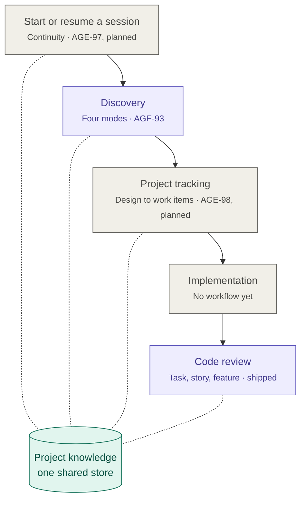
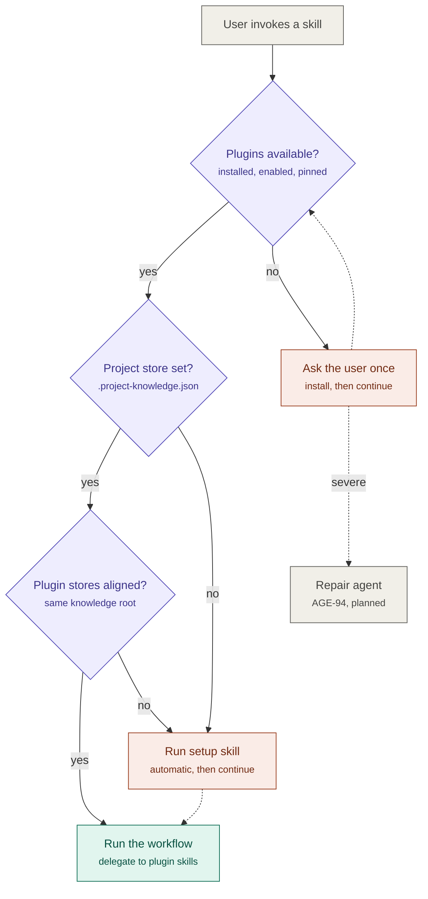
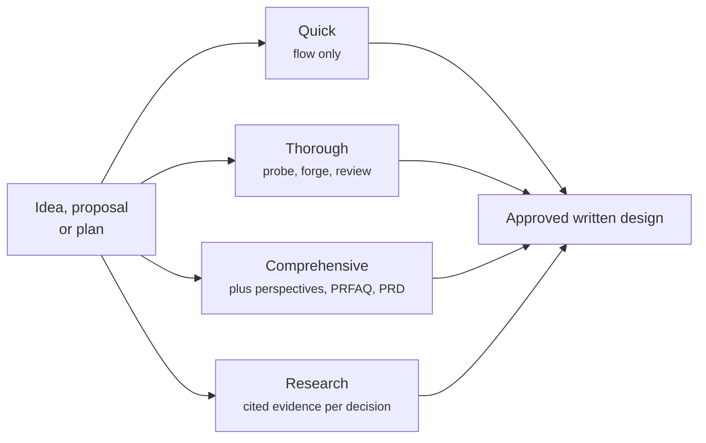
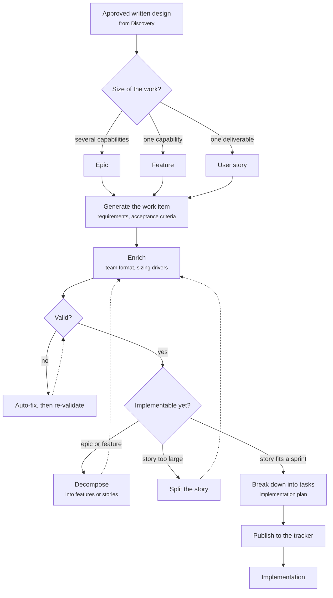
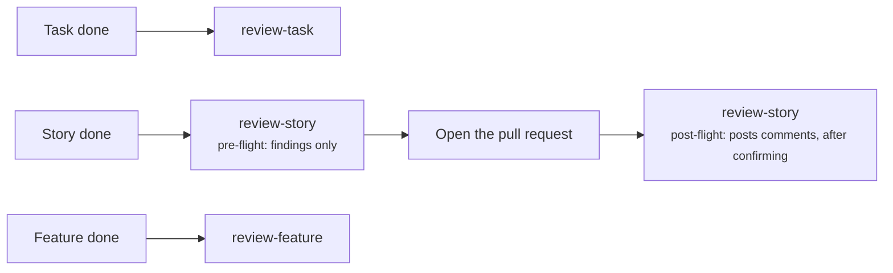

# User journey

The paths a user can take through Unified Plugin Framework: the workflows in the order work flows through them, the readiness checks every workflow skill runs first, and the choices inside each workflow. The design behind it is in the [workflow adapter architecture](work-items/2026-11-15-workflow-adapter-architecture.md) and [ADR-001](adr/ADR-001-workflow-adapter-interface.md).

## The journey

A session starts or resumes with Continuity, then moves through Discovery, project tracking, implementation and code review. Every workflow reads and writes the same project knowledge store.

| Workflow | Plugin behind it | Status |
| --- | --- | --- |
| Continuity | Agent Continuity | Planned: [AGE-97](https://linear.app/agentical-monolithics/issue/AGE-97/continuity-workflow-adapter-agent-continuity) |
| Discovery | Superpowers and BMad Method | In review: [AGE-93](https://linear.app/agentical-monolithics/issue/AGE-93/discovery-workflow-adapter-superpowers-and-bmad-method) |
| Project tracking | Agile Backlog Toolkit | Planned: [AGE-98](https://linear.app/agentical-monolithics/issue/AGE-98/project-tracking-workflow-adapter-agile-backlog-toolkit) |
| Implementation | Not chosen | No workflow or ticket yet |
| Code review | Monolithic Code Review Toolkit | Shipped: [code review workflow](workflows/code-review.md) |
| Project knowledge | Project knowledge plugin | Shipped: used by every workflow |

## Readiness and recovery

Before doing any work, every workflow skill checks its readiness in order. A failing step never stops the work: it has a recovery, after which the skill continues.

- **Ask the user once:** for what only the user can do, such as installing a plugin, or installing the pinned version when the installed one differs from the lock.
- **Run a setup skill:** for what the framework can fix itself, such as creating the project knowledge store or pointing a plugin's own store at it.
- **Repair agent:** for problems no recovery fixes. It explains the problem in one message, proposes a fix, and resumes the work ([AGE-94](https://linear.app/agentical-monolithics/issue/AGE-94/repair-agent-for-severe-workflow-failures)).

From a checkout, `agent-plugin adapter-check <workflow>` runs the same checks and prints each recovery.

## Choices inside the workflows

### Discovery: choose the rigor

Every mode runs the same brainstorming flow from the first question to the written design. The modes differ in what is added to it. Each also offers, once at the start, the optional skills of the catalog it does not already use.

| Mode | Use it when |
| --- | --- |
| `discover-quick` | A clear request, a small change, or a first pass |
| `discover-thorough` | The result must hold up: decisions probed, the idea pressure-tested, the design reviewed |
| `discover-comprehensive` | The work is large, costly or hard to reverse |
| `discover-research` | Decisions depend on facts the user does not have yet |

See the [Discovery workflow](workflows/discovery.md) for which skill is added at each stage.

### Project tracking: from design to work items

Between Discovery and implementation, the approved design becomes work items. The scope of the mapped-out work decides the top-level item; each item is then enriched to the team's format, validated, and broken down until every piece is implementable. Planned in [AGE-98](https://linear.app/agentical-monolithics/issue/AGE-98/project-tracking-workflow-adapter-agile-backlog-toolkit), on the Agile Backlog Toolkit.

| Step | What it does | Toolkit skill |
| --- | --- | --- |
| Generate | Turns the design into an epic, feature or story with requirements and acceptance criteria | `generate-work-item` |
| Enrich | Brings an item into the team's structured format | `enrich-work-item` |
| Validate | Checks an item against the rule set, fixing what it can | `validate-artifact`, `auto-fix-artifact` |
| Decompose | Breaks an epic or feature into parented, audited children | `decompose-backlog` |
| Split | Splits a story too large for one sprint | `split-story` |
| Break down | Writes a story's implementation plan and its tasks | `generate-breakdown-work-items` |
| Amend | Applies later corrections consistently across the whole tree | `amend-workitems` |

As with every workflow, the framework's own tracking skills will name no plugin; the adapter maps them onto these toolkit skills.

### Code review: choose by where you are

| Point in the lifecycle | Operation |
| --- | --- |
| A small unit of work is complete | `review-task` |
| A story is finished, before its pull request | `review-story` (pre-flight) |
| The story's pull request is open | `review-story` (post-flight) |
| A whole feature is complete | `review-feature` |

See the [code review workflow](workflows/code-review.md) for the plugin skills behind each operation.
