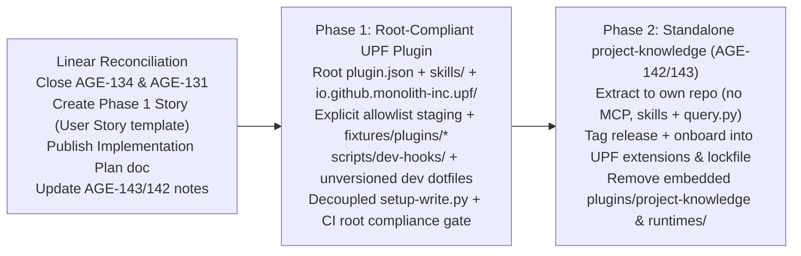

# Implementation Plan: Refactor UPF into a Root-Compliant Agent Plugins v1.0.0 Plugin

## Goal Description

Refactor the `unified-plugin-framework` repository from a multi-plugin monorepo (`plugins/*`) into a **single, root-compliant Agent Plugins Specification v1.0.0 plugin** at the repository root (`.`), while retaining the self-hosted TypeScript toolchain (`packages/*`), keeping the 5 onboarded dependency plugins declared via `plugin.json#extensions["io.github.monolith-inc.upf"]` + `io.github.monolith-inc.upf/onboarded.lock.json`, isolating dev host directories outside git, and preparing for Phase 2 extraction of `project-knowledge` into its own standalone (no-MCP, skills + Python scripts) repository.

After Phase 1 completes:
- `python3 .agent-plugins/agent-plugins-compliance/bin/audit_plugin.py . --format json` and `pnpm agent-plugin validate .` both pass with **`0` fatal / `0` errors / `0` warnings**.
- Any conformant Agent Plugins v1.0.0 host can load `.` directly as the `unified-plugin-framework` plugin (root `plugin.json` + root `skills/*/SKILL.md`, no `mcp.json`).
- UPF's self-hosted compiler, host adapters (`claude`, `codex`, `cursor`), installer, and release pipeline (`packages/*`) stage and package UPF from `.` using an **explicit v1.0.0 plugin file allowlist** (never leaking `packages/`, `fixtures/`, `.git/`, `node_modules/`, or local dotfiles).
- Zero `.claude/`, `.codex/`, `.cursor/`, `.agents/`, `.agent-plugins/`, or `.harness/` files are tracked in git; repo-owned ticket-flow hooks live under `scripts/dev-hooks/`.
- `packages/cli` owns its atomic setup writer (`packages/cli/scripts/setup-write.py`), decoupled from `runtimes/project-knowledge`.



---

## Finalized Architectural Decisions

All design and open questions are resolved:

| # | Area | Decision |
| --- | --- | --- |
| **D1** | `packages/*` & example plugins | Keep `packages/*` (`core`, `compiler`, `installer`, `adapter-*`, `cli`, `workflows`, `project`, `testing`) inside the repo; move `plugins/hello-world` and `plugins/translation` under `fixtures/plugins/`. |
| **D2** | 5 onboarded dependency plugins | Keep declared in root `plugin.json#extensions["io.github.monolith-inc.upf"].onboardedPlugins` + lockfile, fetched/bundled unchanged at release/install time. |
| **D3** | `project-knowledge` | Extract to its own standalone repository (skills + Python scripts, no MCP) and onboard it like the other 5 plugins (**Phase 2**). |
| **D4** | Root `mcp.json` | No root `mcp.json` — skills + CLI/scripts only. |
| **D5** | Extension dir & repo hygiene | Move `onboarded.lock.json` under `io.github.monolith-inc.upf/`. Use explicit plugin allowlist for staging/packaging. Do not version `.claude/`, `.codex/`, `.cursor/`, `.agents/`, `.agent-plugins/`, `.harness/`, etc. |
| **Q1** | Tracked hook scripts (`.claude/hooks/`, `.codex/hooks/`) | **Option A:** Move repo-owned workflow hook scripts & tests to `scripts/dev-hooks/`, update CI `hooks` job and `AGENTS.md`, and untrack + `.gitignore` `.claude/` and `.codex/`. |
| **Q2** | `hello-world` release asset | **Option A:** Make `hello-world` a test-only fixture under `fixtures/plugins/hello-world` (remove from `SHIPPED_PLUGINS` / GitHub releases). |
| **Q3** | Phase ordering | **Option A:** Execute **Phase 1** first (keeping `plugins/project-knowledge` + `runtimes/project-knowledge` temporarily wired while `.` is 100% v1.0.0 compliant), then **Phase 2** (`AGE-142` / `AGE-143` extraction & onboarding). |
| **Q4** | Linear (`P-AGE-6`) housekeeping | **Option A:** Close `AGE-134` (delivered by PR #31) and `AGE-131` (parent `AGE-116` Done), create Phase 1 story using the `AGE` **User Story** template + publish this plan using the **Implementation Plan** document template, and annotate `AGE-143` / `AGE-142` for Decision D3. |
| **AGE-151** | Implementation mode discipline | Attach an explicit **Phase 1 File Inventory** below; if any file outside this inventory must be modified/created/deleted during execution, stop and request explicit user permission first. |

---

## User Review Required

> [!IMPORTANT]
> **Scope Discipline (`AGE-151`):** Execution of Phase 1 is strictly bounded to the **Phase 1 File Inventory** below. If implementation uncovers any additional file that must be created, modified, moved, or deleted outside this list, I will pause and ask for your explicit approval before touching it.

> [!WARNING]
> **Untracking `.claude/` and `.codex/` Locally:** Using `git rm --cached` removes `.claude/` and `.codex/` from git history going forward without deleting your local working files on disk; repo-owned workflow scripts will be copied/moved into `scripts/dev-hooks/` so CI and `AGENTS.md` stay green. Local untracked files currently on `main` (`docs/work-items/2026-11-19-project-knowledge-*.md`, `docs/work-items/user-story-113-*`) will be preserved untouched.

---

## Phase 1 File Inventory (`AGE-151` Scope Contract)

### New Files (`[NEW]`)
- `plugin.json` *(promoted from `plugins/unified-plugin-framework/plugin.json`)*
- `skills/<21-skills>/SKILL.md` *(21 skill directories promoted from `plugins/unified-plugin-framework/skills/`)*
- `io.github.monolith-inc.upf/onboarded.lock.json` *(promoted from `plugins/unified-plugin-framework/onboarded.lock.json`)*
- `fixtures/plugins/hello-world/...` *(moved from `plugins/hello-world/`)*
- `fixtures/plugins/translation/...` *(moved from `plugins/translation/`)*
- `packages/cli/scripts/setup-write.py` *(copied from `runtimes/project-knowledge/src/upf_knowledge/setup_write.py`)*
- `scripts/dev-hooks/ticket-flow.py` *(moved from `.claude/hooks/ticket-flow.py`)*
- `scripts/dev-hooks/require-ticket-branch.sh` *(moved from `.claude/hooks/require-ticket-branch.sh`)*
- `scripts/dev-hooks/after-merge.sh` *(moved from `.claude/hooks/after-merge.sh`)*
- `scripts/dev-hooks/codex-workflow.py` *(moved from `.codex/hooks/workflow.py`)*
- `scripts/dev-hooks/tests/require-ticket-branch.test.sh` *(moved from `.claude/hooks/tests/require-ticket-branch.test.sh`)*
- `scripts/dev-hooks/tests/test_ticket_flow.py` *(moved from `.claude/hooks/tests/test_ticket_flow.py`)*
- `scripts/dev-hooks/tests/test_codex_workflow.py` *(moved from `.codex/hooks/tests/test_workflow.py`)*
- `docs/work-items/<date>-<age-id>-root-compliant-plugin-plan.md` *(repo copy of the approved implementation plan)*

### Modified Files (`[MODIFY]`)
- **Workflows (`packages/workflows`):**
  - `packages/workflows/src/lock.ts`
  - `packages/workflows/src/assemble.ts`
  - `packages/workflows/src/release.ts`
  - `packages/workflows/src/render.ts`
  - `packages/workflows/src/index.ts`
  - `packages/workflows/test/assemble.test.mjs`
  - `packages/workflows/test/code-review.test.mjs`
  - `packages/workflows/test/continuity.test.mjs`
  - `packages/workflows/test/discovery.test.mjs`
  - `packages/workflows/test/implementation.test.mjs`
  - `packages/workflows/test/lock.test.mjs`
  - `packages/workflows/test/project-tracking.test.mjs`
  - `packages/workflows/test/release.test.mjs`
  - `packages/workflows/test/render.test.mjs`
- **Adapters & Compiler / Core / Testing (`packages/adapter-*`, `packages/compiler`, `packages/core`, `packages/testing`):**
  - `packages/adapter-claude/scripts/payload.mjs`
  - `packages/adapter-codex/scripts/payload.mjs`
  - `packages/adapter-cursor/scripts/payload.mjs`
  - `packages/adapter-claude/test/claude.test.mjs`
  - `packages/adapter-codex/test/codex.test.mjs`
  - `packages/adapter-cursor/test/cursor.test.mjs`
  - `packages/compiler/test/adapter-sdk.test.mjs`
  - `packages/compiler/test/contracts.test.mjs`
  - `packages/compiler/test/pipeline.test.mjs`
  - `packages/core/test/authoring.test.mjs`
  - `packages/core/test/inspection.test.mjs`
  - `packages/testing/test/adapter-conformance.test.mjs`
- **CLI & Project (`packages/cli`, `packages/project`, `scripts/`):**
  - `packages/cli/src/tooling-host.ts`
  - `packages/cli/src/tooling-runtime.ts`
  - `packages/cli/src/tooling-files.ts`
  - `packages/cli/src/plugin-facts.ts`
  - `packages/cli/src/dependency-sources.ts`
  - `packages/cli/src/upgrade-check.ts`
  - `packages/cli/scripts/release-assets.mjs`
  - `packages/cli/scripts/release-distribution.mjs`
  - `packages/cli/scripts/check-distribution.mjs`
  - `packages/cli/test/adapter-check.test.mjs`
  - `packages/cli/test/dependency-fetch.test.mjs`
  - `packages/cli/test/install-release.test.mjs`
  - `packages/cli/test/install-shipped.test.mjs`
  - `packages/cli/test/install.test.mjs`
  - `packages/cli/test/m1-integration.test.mjs`
  - `packages/cli/test/onboarded-helpers.mjs`
  - `packages/cli/test/release-evidence.test.mjs`
  - `packages/cli/test/translation-dogfood.test.mjs`
  - `packages/cli/test/translation-plugin.test.mjs`
  - `packages/cli/test/upgrade-check.test.mjs`
  - `packages/project/test/connector.test.mjs`
  - `scripts/install-release.mjs`
- **Repo Hygiene, CI & Docs:**
  - `.gitignore`
  - `.github/workflows/ci.yml`
  - `AGENTS.md`
  - `README.md`
  - `docs/agent-plugins-specification.md`
  - `docs/architecture.md`
  - `docs/workflows/tooling-bootstrap.md`
  - `docs/workflows/code-review.md`

### Deleted / Untracked from Git (`[DELETE]`)
- `plugins/unified-plugin-framework/` *(deleted after promotion to `.`, `skills/`, `io.github.monolith-inc.upf/`)*
- `plugins/hello-world/` *(moved to `fixtures/plugins/hello-world/`)*
- `plugins/translation/` *(moved to `fixtures/plugins/translation/`)*
- `.claude/agent-continuity.config.json`, `.claude/settings.json`, `.claude/hooks/*` *(untracked via `git rm --cached`; hook scripts relocated to `scripts/dev-hooks/`)*
- `.codex/hooks.json`, `.codex/hooks/*` *(untracked via `git rm --cached`; hook script relocated to `scripts/dev-hooks/`)*

---

## Proposed Changes

### Component 1: Linear Board Reconciliation (`P-AGE-6`)

Before creating the Phase 1 branch:
1. Mark **`AGE-134`** (`Plugin reader follows the Agent Plugins specification`) **Done** with a comment referencing merged PR #31 (`272072b`).
2. Mark **`AGE-131`** (`Review` subtask under already-Done `AGE-116`) **Done** (or Canceled) to clear the orphaned task.
3. Create the **Phase 1 User Story** on `P-AGE-6` using the `AGE` **User Story** template (`1f59cc3c-128d-4cd0-a7b1-14a09da94e69`), and create a linked Linear **Implementation Plan** document on `P-AGE-6` using template `b9ff0245-6187-4904-aed9-33132c075341`.
4. Add a concise architecture comment/update to **`AGE-143`** and **`AGE-142`** recording Decision D3 (extracting `project-knowledge` into its own standalone no-MCP repo and onboarding it in Phase 2) and noting **`AGE-151`**'s file-inventory discipline.

---

### Component 2: Root Plugin Package Layout & Fixtures

Promote UPF's manifest, skills, and lockfile to standard v1.0.0 locations at `.`:
- `plugins/unified-plugin-framework/plugin.json` → `/plugin.json`
- `plugins/unified-plugin-framework/skills/*` → `/skills/*`
- `plugins/unified-plugin-framework/onboarded.lock.json` → `/io.github.monolith-inc.upf/onboarded.lock.json`
- `plugins/hello-world/` → `fixtures/plugins/hello-world/`
- `plugins/translation/` → `fixtures/plugins/translation/`
- *(Phase 1 only: `plugins/project-knowledge/` and `runtimes/project-knowledge/` remain in place until Phase 2 extracts them.)*

---

### Component 3: Workflows — Allowlist Staging, Extension Lock Path, Root Release Sources (`packages/workflows`)

#### [MODIFY] [lock.ts](file:///home/monolith/projects/unified-plugin-framework/packages/workflows/src/lock.ts)
```ts
export const LOCK_FILE = "io.github.monolith-inc.upf/onboarded.lock.json";
export const LEGACY_LOCK_FILE = "onboarded.lock.json";
```
Add a pure path-selection helper so readers prefer `LOCK_FILE` and gracefully read `LEGACY_LOCK_FILE` only when inspecting legacy test fixtures, while writers always target `LOCK_FILE`.

#### [MODIFY] [assemble.ts](file:///home/monolith/projects/unified-plugin-framework/packages/workflows/src/assemble.ts)
Replace `cpSync(sourceRoot, stagingRoot, { recursive: true })` with an explicit allowlist copy:
- Always copy allowlisted root files if present: `plugin.json`, `mcp.json`, `LICENSE`, `NOTICE`.
- Copy `skills/` if present, then overwrite each rendered `SKILL.md` in `stagingRoot`.
- Copy declared reverse-domain extension directories matching keys in `plugin.json#extensions` (e.g., `io.github.monolith-inc.upf/`), verifying symlink containment.
- Never copy `packages/`, `fixtures/`, `docs/`, `runtimes/`, `scripts/`, `node_modules/`, `.git/`, or dotfiles.

#### [MODIFY] [release.ts](file:///home/monolith/projects/unified-plugin-framework/packages/workflows/src/release.ts)
- Remove `"hello-world"` from `SHIPPED_PLUGINS` (`["unified-plugin-framework", "project-knowledge"]` in Phase 1; `["unified-plugin-framework"]` in Phase 2).
- Replace `pluginsRoot: string` in `ReleaseLayout` with `sources: readonly ShippedSource[]` (plus helper `repositoryShippedSources(repoRoot)` mapping `unified-plugin-framework` → `repoRoot` and, during Phase 1, `project-knowledge` → `join(repoRoot, "plugins/project-knowledge")`).
- Ensure `withAssembledSource` uses a safe leaf directory name (`pluginDirectoryName(manifest.name)` or `"plugin"`) inside scratch when `sourceRoot` is `.`.

#### [MODIFY] [render.ts](file:///home/monolith/projects/unified-plugin-framework/packages/workflows/src/render.ts)
Update the generated skill header comment from `plugins/unified-plugin-framework` to `skills/`.

---

### Component 4: CLI, Adapters, Installer & Release Scripts (`packages/cli`, `packages/adapter-*`, `scripts/`)

#### [NEW] `packages/cli/scripts/setup-write.py` & [MODIFY] [tooling-files.ts](file:///home/monolith/projects/unified-plugin-framework/packages/cli/src/tooling-files.ts)
Copy `runtimes/project-knowledge/src/upf_knowledge/setup_write.py` to `packages/cli/scripts/setup-write.py` and point `WRITER` in `tooling-files.ts` at `new URL("../scripts/setup-write.py", import.meta.url)`.

#### [MODIFY] [tooling-host.ts](file:///home/monolith/projects/unified-plugin-framework/packages/cli/src/tooling-host.ts) & [tooling-runtime.ts](file:///home/monolith/projects/unified-plugin-framework/packages/cli/src/tooling-runtime.ts)
- Set `FRAMEWORK_PLUGIN = FRAMEWORK_ROOT`.
- Add `frameworkPluginRoot(name)` returning `FRAMEWORK_ROOT` for `"unified-plugin-framework"` (and `join(FRAMEWORK_ROOT, "plugins", name)` for `"project-knowledge"` until Phase 2).

#### [MODIFY] [upgrade-check.ts](file:///home/monolith/projects/unified-plugin-framework/packages/cli/src/upgrade-check.ts)
Create `dirname(path)` (`mkdirSync(dirname(path), { recursive: true })`) before writing `join(framework, LOCK_FILE)`.

#### [MODIFY] [packages/adapter-*/scripts/payload.mjs](file:///home/monolith/projects/unified-plugin-framework/packages/adapter-claude/scripts/payload.mjs), [release-assets.mjs](file:///home/monolith/projects/unified-plugin-framework/packages/cli/scripts/release-assets.mjs), [release-distribution.mjs](file:///home/monolith/projects/unified-plugin-framework/packages/cli/scripts/release-distribution.mjs), [scripts/install-release.mjs](file:///home/monolith/projects/unified-plugin-framework/scripts/install-release.mjs)
- Point all payload and release asset builders at `repositoryShippedSources(repository)`.
- In `release-distribution.mjs`, set `framework = repository` and copy an explicit allowlist (`plugin.json`, `skills`, `io.github.monolith-inc.upf`, `packages/cli/scripts/setup-write.py`, plus `plugins/project-knowledge` and `runtimes/project-knowledge` in Phase 1 only).
- In `scripts/install-release.mjs`, update `SOURCE_MARKERS` to `['plugin.json', 'io.github.monolith-inc.upf/onboarded.lock.json', 'packages/cli/package.json']`.

---

### Component 5: Dev Directory Hygiene, `scripts/dev-hooks/`, CI Gate & Docs

1. Move `.claude/hooks/*` and `.codex/hooks/*` (plus tests) into `scripts/dev-hooks/` (updating internal script paths in `ticket-flow.py`, `require-ticket-branch.sh`, `after-merge.sh`, `codex-workflow.py`, and their tests).
2. Untrack `.claude/` and `.codex/` from git (`git rm --cached -r .claude .codex`) and add `/.agent-plugins/`, `/.agents/`, `/.claude/`, `/.codex/`, `/.cursor/`, `/.fp-enforcer/`, `/.harness/`, `/.monolithic-code-review/`, `/.superpowers/`, `/_bmad/`, `/_bmad-output/` to `.gitignore`.
3. Update `.github/workflows/ci.yml`:
   - Point the `hooks` job at `scripts/dev-hooks/tests/`.
   - Add a **Root v1.0.0 Compliance & Hygiene** check to the `quality` job:
     - `pnpm agent-plugin validate .` (assert 0 errors and 0 warnings)
     - Assert `git ls-files .claude .codex .cursor .agents .agent-plugins .harness` returns empty.
4. Update `AGENTS.md`, `README.md`, `docs/agent-plugins-specification.md`, `docs/architecture.md`, `docs/workflows/tooling-bootstrap.md`, and `docs/workflows/code-review.md` to reference `scripts/dev-hooks/ticket-flow.py`, root `plugin.json`, root `skills/`, `io.github.monolith-inc.upf/onboarded.lock.json`, and `fixtures/plugins/`.

---

### Phase 2 (Follow-Up Ticket — `AGE-142` / `AGE-143` / `AGE-147` / `AGE-149`)

Executed in a separate PR after Phase 1 lands:
1. Create standalone `project-knowledge` repository (root `plugin.json`, root `skills/`, stdlib Python 3.12+ `query.py` & five-tier store, **no MCP**), verify `audit_plugin.py .` passes with 0 findings, and tag its release.
2. Add `project-knowledge` to UPF root `plugin.json#extensions["io.github.monolith-inc.upf"].onboardedPlugins` and pin it in `io.github.monolith-inc.upf/onboarded.lock.json`.
3. Remove `plugins/project-knowledge/`, `runtimes/project-knowledge/`, the Python MCP CI jobs in `.github/workflows/ci.yml`, and the embedded `project-knowledge` MCP venv code in `packages/cli` (`FRAMEWORK_PLUGINS = ["unified-plugin-framework"]`).

---

## Verification Plan

### Automated Tests

Run once after all Phase 1 edits are complete (narrow package checks while iterating):

```bash
# 1. Normative Agent Plugins v1.0.0 audit on repository root (must be PASS: 0F / 0E / 0W)
python3 .agent-plugins/agent-plugins-compliance/bin/audit_plugin.py . --format json

# 2. Full workspace install, typecheck, build, and test suite
pnpm install --frozen-lockfile
pnpm typecheck
pnpm build
pnpm test

# 3. UPF's own validator against repository root (0 errors, 0 warnings)
pnpm agent-plugin validate .

# 4. Multi-host payload compilation, determinism, and Claude Code official validator
pnpm payloads:verify

# 5. Release assets & complete distribution end-to-end verification
pnpm release:assets
pnpm release:distribution
node packages/cli/scripts/check-distribution.mjs

# 6. Relocated dev-hook tests
bash scripts/dev-hooks/tests/require-ticket-branch.test.sh
python3 -B -m unittest discover -s scripts/dev-hooks/tests -p 'test_*.py' -v

# 7. Verify zero dev host directories are tracked in git
test -z "$(git ls-files .claude .codex .cursor .agents .agent-plugins .harness)"
```

### Manual Verification

1. Inspect `pnpm payloads:build` output for Claude, Codex, and Cursor to confirm only allowlisted plugin files (`skills/`, host manifest, etc.) are included — zero leakage from `packages/`, `docs/`, `fixtures/`, `.git/`, or local dotfiles.
2. Inspect `tar -tzf release-assets/unified-plugin-framework-0.0.0-dev.tar.gz` to verify root `plugin.json`, `skills/`, `io.github.monolith-inc.upf/onboarded.lock.json`, and `packages/cli/scripts/setup-write.py` are cleanly packaged.
3. Verify Linear `P-AGE-6` reflects `AGE-134` Done, `AGE-131` Done, the new Phase 1 User Story + Implementation Plan document, and the `AGE-142`/`AGE-143` notes.
