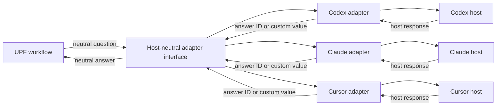
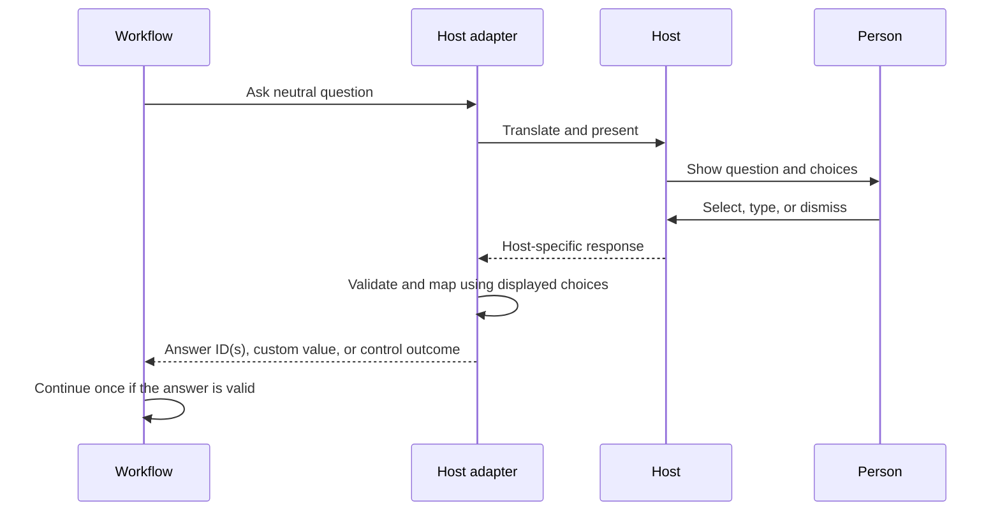
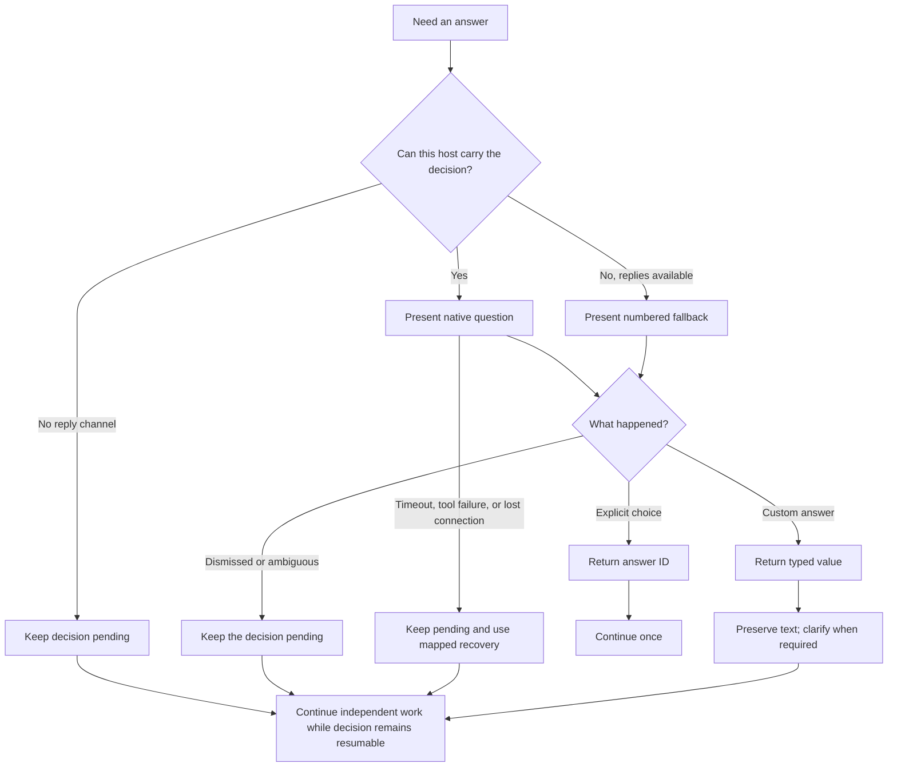
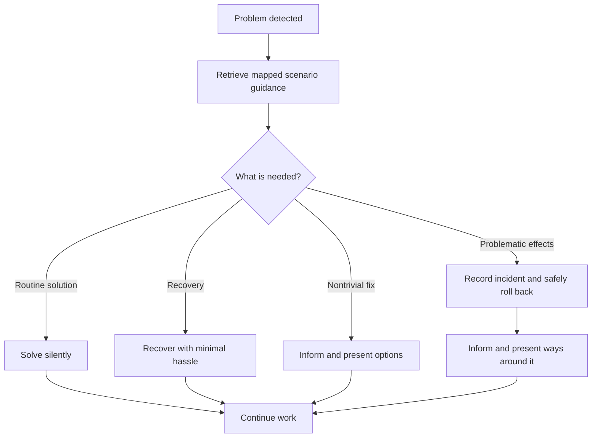

# Host question integration: representations for review

Status: proposed. This document is a review model, not an implemented interface or a claim that every host exposes an automatic callback.

## System boundaries



The adapters translate vendor-specific inputs and outputs. The workflow does not parse vendor payloads. Current vendor packages generate payloads; whether they should gain runtime capabilities or compose a separate runtime adapter is unresolved.

## Minimal proposed interface

Illustrative TypeScript; reuse existing project types where they fit. `Task` describes a deferred effect, and the error type must match the project's existing result conventions.

```typescript
type AnswerId = string;

type Answer =
  | { readonly kind: "selected"; readonly ids: readonly AnswerId[] }
  | { readonly kind: "custom"; readonly value: string };

type QuestionResult =
  | { readonly kind: "answered"; readonly answer: Answer }
  | { readonly kind: "dismissed" }
  | { readonly kind: "unavailable" };

interface QuestionAdapter {
  readonly ask: (question: Question) => Task<Result<QuestionResult>>;
}
```

For a single fixed choice, `ids` contains one answer ID. For a multiple choice, it contains the chosen IDs. Custom text is present only when the person supplies it. Dismissed and unavailable are control outcomes, not answer IDs. Confirmation uses ordinary answer IDs for accept and decline; only an explicit, unambiguous accept ID grants consent.

The example shows the logical contract, not an assertion that a host can implement a blocking `ask`. An asynchronous callback implementation may use an equivalent prepare/receive interface if the real host requires it. Decision correlation and duplicate protection remain internal to the adapter and existing continuation owner, not extra fields in the answer returned to the workflow.

## Neutral question template

```text
Question: Which format?
Answers in display order:
  csv  → CSV
  json → JSON
Custom answer: allowed
```

The labels are for presentation; `csv` and `json` are stable IDs. A concrete adapter derives the displayed order and mapping from the same question. It returns `json` when the person selects JSON, and the typed value when the person gives a custom answer. Duplicate or ambiguous labels must not become a guessed ID.

## Review template

```text
Title: Migration plan
Purpose: Move the data safely
Material: Back up, migrate, verify
Revision: r1
Question: Approve this plan?
Answer IDs: approve, decline
```

The host presents the material or a usable link before the question. The existing workflow owns the revision and associates the answer with it; a changed revision requires a new decision. Displaying the review, dismissing the prompt, or a default value is not approval.

An unanswered decision remains pending and resumable. The runtime continues independent authorized work. For mapped failures, it retrieves the relevant timeout, escape and recovery route from discrete knowledge-indexed guidance. It applies the product-wide problem handling in `../upf-continuous-workflow-constitutional-article.md`.

## Flow





## Problem recovery



Only independent authorized work continues while a necessary human decision is pending. A timeout does not count as a reply. If a replacement prompt is issued, a late response to its predecessor cannot advance the decision. Custom text is passed to the workflow, which may retain it for clarification rather than advancing.

## Current versus proposed

| Representation | Current merged implementation | Proposed change |
|---|---|---|
| Shared question | `Question`, decision context, stable keys | Reuse; make one ordering authoritative for display and decoding. |
| Answer normalization | `QuestionResponse` and `normalizeQuestionAnswer` | Reuse behind the adapter; keep host-specific payloads outside the workflow. |
| Host adapter | Existing vendor adapters compile payloads | Add or compose the smallest supported runtime question capability. |
| Review display | Blueprint guidance and readable fallback | Keep; verify actual presentation and revision binding in the real host. |
| Continuation | Caller retains state and calls the answer command | Connect an observed supported host response automatically; establish the existing owner of consumption. |

## Evidence limits

- The Codex desktop displayed the specimen and native buttons. The selected answer was manually converted into the CLI input, so automatic callback delivery has not been proven.
- The installed Codex app-server schema describes an answer map, but does not by itself prove a plugin can receive the existing desktop client's callback. [OpenAI app-server](https://developers.openai.com/codex/app-server/)
- [Claude Code](https://code.claude.com/docs/en/hooks) documents question inputs and general tool hooks. [Cursor](https://cursor.com/docs/hooks) documents generic tool hooks and some redaction. The exact native question callbacks and payloads still need version-specific confirmation.
- Each concrete host implementation requires the host vendor's official documentation and an observation for the installed version. Unsupported or unverified host paths retain a safe fallback.
